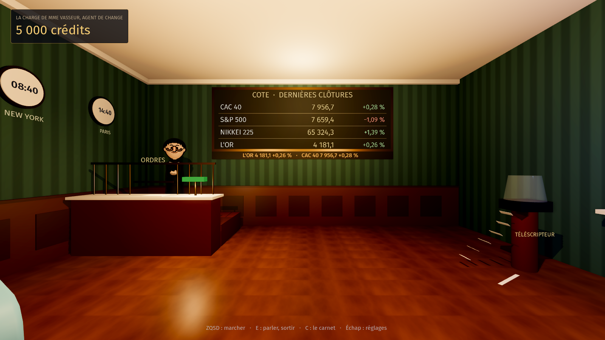
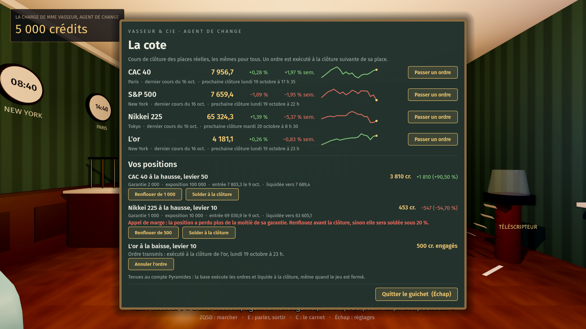
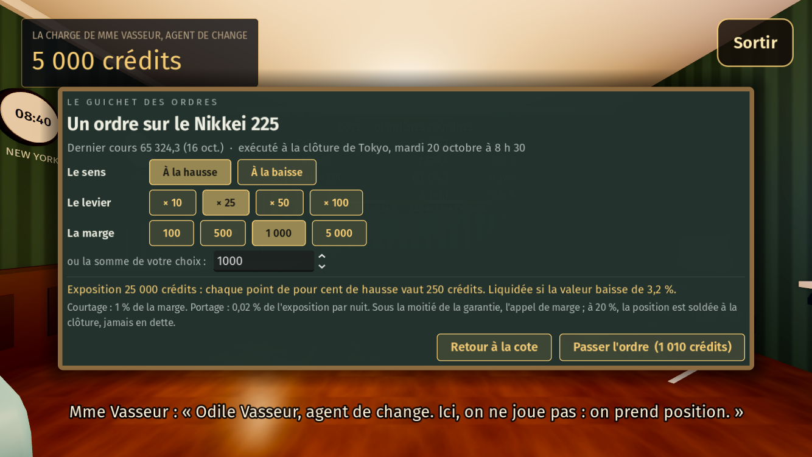
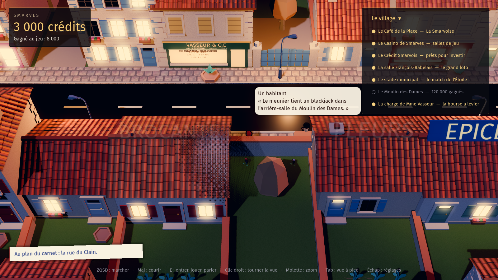

# La bourse à levier : la charge de Mme Vasseur

Demande de Guillaume du 18 octobre 2026 : « la spéculation boursière dans une bourse connectée à quelques indices réels, mais avec simplement des leviers énormes pour que des variations de l'ordre de la semaine soient déjà sensibles. » Elle suit le modèle des activités transverses ([`ACTIVITES.md`](ACTIVITES.md)) : un rendez-vous au vrai calendrier (les clôtures), un résultat commun (les mêmes cours pour tous, tenus au serveur), un lieu, une fenêtre de la famille de l'ardoise, et de l'argent qui dit ce qu'il est.

## La fiche

| | |
|---|---|
| Lieu | **La charge de Mme Vasseur, agent de change** (« Vasseur & Cie »), dans le local réservé de la rue du Clain (`lot_reserve`). Avant le seuil, la vitrine reste passée au blanc, « Prochainement », rien ne change dans la rue. |
| Seuil | **7 000 crédits gagnés au jeu** (`commune.json`, lieu `bourse`). Rien ne change dans la salle du café ni sur la place. |
| Hôte | **Mme Vasseur**, chignon, robe ardoise, lunettes en demi-lune et carnet, derrière la grille de laiton de son guichet. |
| Valeurs | **CAC 40** (`^FCHI`, Paris, clôture 17 h 35), **S&P 500** (`^GSPC`, New York, 16 h), **Nikkei 225** (`^N225`, Tokyo, 15 h 30), **l'or** (`GC=F`, New York, 17 h). |
| Source | Les clôtures quotidiennes du graphique public de Yahoo Finance (`query1.finance.yahoo.com/v8/finance/chart`), relevées **au serveur** par la base de Pyramides (pg_net, tâche pg_cron toutes les quinze minutes) et gardées dans `smarves.cours` : tout le monde voit les mêmes cours, et le jeu ne parle jamais à Yahoo. |
| Ordre | À la hausse ou à la baisse, levier **×10, ×25, ×50 ou ×100**, marge de 100 à 1 000 000 crédits, **1 % de courtage** à l'ouverture. Au plus huit positions ouvertes. |
| Exécution | **À la clôture suivante de la place**, à l'heure du serveur : on ne peut pas jouer un cours déjà connu. Un ordre pas encore exécuté peut être annulé, tout est rendu (courtage compris). Le solde demandé s'exécute lui aussi à la clôture suivante. |
| Valeur | `garantie + exposition × sens × (cours / cours d'entrée − 1) − portage`, avec `exposition = marge × levier`, `garantie = marge + renforts` et un **portage** de 0,02 % de l'exposition par nuit. |
| Appel de marge | Sous **50 %** de la garantie : la position s'affiche en rouge, Mme Vasseur le dit, le carnet aussi. On peut **renflouer** (verser de quoi s'éloigner de la liquidation) ou solder. |
| Liquidation | À une clôture où la valeur tombe à **20 %** de la garantie ou moins : la position est fermée d'office à ce cours, le reste est rendu (au levier ×50, une baisse de 1,6 % ; au ×100, de 0,8 % ; au ×10, de 8 %). **Jamais de dette** : on ne perd jamais plus que ce qu'on a engagé. |
| Le rendez-vous | Les ouvertures et clôtures de Paris chaque jour ouvré, et les clôtures des places où l'on tient une position (`Bourse.rendez_vous(de, a)`, pour l'agenda de la semaine). |

## L'argent

- **Ce qui sort** : la marge, le courtage et les renforts passent par `Game.spend`, donc comptent dans les mises (`staked`).
- **Ce qui revient** : à la position soldée, liquidée ou annulée, le rendu entre dans les crédits (`smarves_bourse_encaisser`, une seule fois, à un seul appareil). **Seul le bénéfice** (`rendu − garantie`, s'il est positif) entre dans le total gagné : une perte n'y touche pas, et rouvrir sans fin la même somme ne fait pas monter les seuils.
- **Le bilan** depuis le début (engagé, revenu) est gardé dans le tiroir de Smarves et s'affiche sous les positions, sans commentaire.

### Sources et puits de crédits, pour l'équilibrage

- **Puits** : le courtage (1 % de chaque marge), le portage (0,02 % de l'exposition par nuit, soit 0,2 % de la marge par nuit au ×10 et 2 % au ×100), et ce que gardent les liquidations (au moins 80 % de la garantie).
- **Source** : les bénéfices des positions soldées, qui suivent le vrai marché. Les indices montent en moyenne de l'ordre de 0,03 % par séance ; au ×10, le portage annule à peu près cette dérive, et au-delà il la dépasse : sur la durée, la bourse prend plus qu'elle ne rend, et elle rend gros à qui devine la semaine.
- Aucun lien avec M. Brunet ni avec Maître Garnier pour l'instant : on ne joue à la bourse qu'avec ses crédits, et une position n'est pas un bien qu'on finance ou qu'on reprend.

## Le compte

Les positions sont tenues **au serveur**, sur le compte Pyramides (`smarves.positions`, `smarves.renforts`) : on les retrouve sur tous ses appareils. Sans compte, la cote se lit mais Mme Vasseur ne prend pas d'ordre (la fenêtre le dit). Le jeu relit la cote au plus toutes les deux minutes quand on est chez elle, et toutes les dix minutes en fond, pour encaisser ce qui a été soldé ailleurs.

Fonctions publiques (migration `supabase/migrations/20261019000000_smarves_bourse.sql`) : `smarves_bourse(p_jeton)`, `smarves_bourse_ouvrir`, `smarves_bourse_renflouer`, `smarves_bourse_solder`, `smarves_bourse_encaisser`. Le suivi d'une position (entrée, liquidation clôture par clôture, solde) est fait par la base à chaque lecture, sur les clôtures relevées.

## Le lieu

`scenes/bourse.tscn` (`scripts/village/charge.gd`) : le guichet et sa grille de laiton, le tableau de la cote au mur du fond (les quatre valeurs, leur séance, un bandeau orange qui défile), trois horloges (Paris, New York, Tokyo), le téléscripteur qui sort une dépêche, deux fauteuils. E devant le tableau ou devant Mme Vasseur ouvre la cote (`BoursePanel`, `scripts/socle/bourse_panel.gd`) : chaque valeur, son dernier cours, sa séance, sa semaine, sa courbe et « Passer un ordre » ; puis vos positions (valeur, résultat, garantie, exposition, cours d'entrée, cours de liquidation, appel de marge), « Renflouer » et « Solder » ; les dernières positions closes et le bilan. Sur un téléphone, la fenêtre tient dans l'écran et défile. On sort par « Quitter le guichet (Échap) ».

Dans la rue, au seuil, la vitrine du local réservé prend son enseigne verte et or, « VASSEUR & CIE, Agent de change · Bourse · Titres », sa fenêtre s'allume, et la porte mène chez Mme Vasseur.

## Tester

- `godot --headless --path . -s tools/test_bourse.gd` : les heures des places (été, hiver), les séances, les rendez-vous de l'agenda, l'argent qui revient, les écritures, la fenêtre sur ordinateur et sur téléphone.
- Capture avec une cote d'essai (mi-octobre 2026, trois positions dont une en appel de marge) : `godot --path . res://scenes/bourse.tscn -- --capture=cote.png --bourse-essai --won=7000 --open=cote` (ou `--ordre=cac40` pour le guichet des ordres ; `--resolution 1067x600 … --tactile --base=600` pour un téléphone).
