# La suite de Smarves : cadrage et architecture

Ce document dit où va Smarves après le prototype du village, et les choix d'architecture qui en découlent. Il part de la direction donnée par Guillaume le 17 octobre 2026 : un village à parcourir avec de l'exploration, comme la ville d'Addict Casino ; une vue extérieure plus dézoomée ; du housing ; du multi ; et, à terme, une carte de la Vienne où d'autres communes se greffent par des mods.

Chaque point donne une proposition tranchée, puis les alternatives écartées en une ligne. Rien ici n'est implémenté : c'est la feuille de route des prochains chantiers. La fiche de cadrage ([`CADRAGE.md`](CADRAGE.md)) reste la définition du jeu, la bible ([`BIBLE.md`](BIBLE.md)) celle du monde, et ces deux documents l'emportent en cas de doute.

Les règles qui ne bougent pas :

- **Rien ne change dans la première salle.** Le Café de la Place, la place de la Mairie et la salle des jeux du casino gardent leurs jeux, leurs règles et leurs seuils. Tout ce qui est nouveau s'ouvre par un seuil ou se trouve en marchant.
- **Le gameplay des jeux est en pause, le visuel passe d'abord.** Les nouveaux lieux sont d'abord du décor avec figurants ou des portes fermées, qu'on ouvrira plus tard par des seuils.
- **La morale reste au premier degré.** Elle sort des chiffres, jamais d'un personnage. Le housing et le multi suivent la même règle.
- **Le public a entre 30 et 45 ans.** Le ton est coloré et décalé face à l'argent, jamais enfantin. Les personnages sont des humains (fil « Personnages », ligne claire), il n'y a pas d'animaux.
- **Aucune migration de la base de production** sans l'accord explicite de Guillaume.

## En bref : l'ordre des chantiers

1. **La caméra dézoomée et la lisibilité** (personnages, toits, enseignes), parce que tout le reste se juge à cette distance.
2. **Le socle « commune »** : Smarves décrit par un manifeste, la sauvegarde rangée en tiroirs, sans aucun changement visible.
3. **Le village à parcourir** : la route du Bois, le chemin de Passelourdin, le plan du village qui se dévoile en marchant, les repères et les trouvailles.
4. **Le housing** : la chambre au-dessus du café habitable et meublable, puis les deux maisons.
5. **La carte de la Vienne** avec Smarves seule, puis une deuxième commune livrée en pack séparé pour éprouver la greffe. *Fait le 18 octobre 2026* : la carte est un écran du jeu (dézoomer au-delà du cran « quartier », ou M), Ligugé est la commune d'essai en paquet (notice : [`COMMUNE.md`](COMMUNE.md), « L'écran de la carte »). Reste le car départemental depuis l'arrêt de la place.
6. **La connexion au compte** Pyramides, avec la partie gardée sur le compte. *Fait le 18 octobre 2026.*
7. **Le multi asynchrone** (multi différé) : visites de maisons, livre d'or, classements. *Fait le 18 octobre 2026* : panneau d'affichage, noms sur les maisons, livre d'or, traces de passage (section 4).
8. **Le multi en temps réel** : la soirée partagée sur la place, les tables à plusieurs, le poker de Passelourdin.

**Ordre tranché par Guillaume le 17 octobre 2026** : une fois le mobile au point, la connexion au compte, puis le multi différé, puis le temps réel. La carte de la Vienne n'en dépend pas et se fait en parallèle.

9. **Les structures partagées et le championnat de la Vienne** (section 6) : une commune déclare sa gare, son arrêt de car, son terrain de football ; le socle tient le registre ; toute commune avec un terrain a un club dans la pyramide du football de la Vienne. *Commencé le 18 octobre 2026* : le champ « structures », le registre, et la pyramide elle-même (saisons, montées et descentes), sans rien à l'écran encore.

Le détail et l'impact sur les fils en cours sont à la section 7.

## 1. Le village à parcourir

### Ce qu'on vise

Le joueur sort du café et a envie d'aller voir ce qu'il y a au bout de la rue. Le village est une seule maquette continue, qu'on parcourt à pied (et plus tard avec sa Mobylette ou sa 2 CV), où chaque rue mène quelque part, où l'on voit de loin ce qu'on n'a pas encore atteint, et où l'on trouve des choses que personne n'a signalées.

### La boucle d'exploration

1. **On voit un repère de loin.** Chaque quartier a un repère qui dépasse des toits et se reconnaît en vue dézoomée : le clocher de Saint-Félix, l'enseigne « CASINO » allumée sur le toit du casino, l'érable rouge de la place, le château d'eau de la route du Bois, la roue du Moulin des Dames, les falaises de Passelourdin éclairées au-dessus des toits. Le repère dit « il y a quelque chose là-bas » sans dire quoi.
2. **On suit un chemin.** Les rues sont la seule chose qui guide : pas de flèche ni d'objectif à l'écran. Un panneau de bois aux carrefours, des plaques de rue émaillées, une guirlande d'ampoules qui continue au coin d'une rue.
3. **On découvre un lieu.** Trois sortes de lieux :
   - **les lieux de jeu**, qui s'ouvrent par leur seuil comme aujourd'hui (le tenancier fait signe ; avant le seuil, la porte est fermée et l'invite donne le montant) ;
   - **les lieux de décor**, ouverts à tous : le lavoir, la placette, le stade, l'école, la cabine de la poste, avec des figurants qui y vivent ;
   - **les lieux cachés**, qu'aucune liste n'annonce : une cour derrière un portail entrouvert, une cave à la porte basse, un jardin au bout d'une ruelle. Certains sont seulement trouvés en marchant, d'autres s'ouvrent par un seuil sans prévenir (la porte était fermée hier, elle est entrouverte aujourd'hui).
4. **La découverte rapporte, sans rien changer aux jeux.** Trouver un lieu caché inscrit une ligne au carnet, ajoute la rue au plan du village et donne souvent une rumeur ou une **trouvaille** : un objet de décor qu'on rapporte chez soi (le ticket de tiercé encadré de Dédé, la boule de pétanque gravée de Lucien, une affiche du loto de 1987). Les trouvailles ne valent aucun crédit, ne comptent pas dans « Gagné au jeu » et ne touchent à aucun seuil : elles servent au housing (section 3) et à la collection. Une trouvaille rare se montre aux visiteurs.

### Ce qu'on reprend d'Addict Casino

| Dans Addict | À Smarves |
|---|---|
| La minicarte où les rues n'apparaissent qu'une fois parcourues | **Le plan du village**, une page du carnet dessinée au crayon, qui se remplit à mesure qu'on marche ; les lieux de jeu y sont inscrits à l'encre quand ils sont ouverts |
| Les plaques de rue émaillées aux carrefours | les plaques, avec les vrais noms des rues du bourg quand ils existent |
| 212 bâtiments numérotés, fermés, chacun avec son lot et son adresse ; frapper donne l'adresse | chaque porte du village a un lot (`Village.lots`) et une adresse ; une porte fermée répond (« Personne. Repassez après le loto. ») |
| Un projet extérieur occupe un lot en ajoutant une ligne à un annuaire | les lots libres (`lot_reserve`, `lot_a_ceder`) et les communes greffées (section 5) |
| Les îlots construits en détail près du joueur, en boîtes au-delà | même principe, par quartier, pour tenir la vue dézoomée et une machine modeste |
| Les salles en 3D construites à la première visite, figurants animés seulement près du joueur | les intérieurs du village (boutiques, maisons, caves) suivent la même règle |
| Le taxi qu'on hèle de n'importe quelle rue | **le véhicule qu'on possède** (Mobylette, 2 CV, DS, achetés chez Roger Fradin) sert de déplacement rapide vers les lieux déjà découverts ; sans véhicule, on marche |
| Une ville qui existe avant qu'on la voie, et qu'un seuil révèle | **les rues fermées par des barrières de chantier** (« Travaux. Le comité des fêtes vous remercie. ») tant que leur seuil n'est pas atteint |

### Ce qu'on ne reprend pas

- **Le jour réel, le salaire, l'impôt et les crises de la ville d'Addict.** À Smarves, le temps se compte en mises et la recette tombe toutes les 20 mises (GESTION.md). Un village qui vivrait sans le joueur changerait l'économie, qui est en pause.
- **La limousine et le survol unique.** Le village se découvre à pied ; il n'y a pas de grande révélation au million.
- **La sécurité, le patron, la cave et le casse.** Ils appartiennent au casino d'Addict, pas au village.
- **Les bâtiments greffés en page web dans une fenêtre isolée.** Smarves est un jeu Godot : la greffe se fait par commune entière (section 5), pas par page.

**Alternatives écartées.** Des quêtes avec objectifs à l'écran : contraire au ton, la rumeur suffit. Un village ouvert en entier dès le départ : on perd la clé unique des seuils. Un monde procédural : Smarves est un vrai village, sa géographie est écrite à la main.

## 2. La vue extérieure dézoomée

Le fil « Extension du village » prototype la caméra ; ce chapitre donne les recommandations, transmises par le coordinateur. Je ne touche pas à la caméra.

### Aujourd'hui

En vue de dessus, la caméra suit l'habitant à 9 unités, inclinée à 48°, avec un champ vertical de 34° (`main.gd`, `set_fps`). À l'échelle de la maquette, une unité vaut environ 2,4 m (un habitant mesure 0,7 unité, la route 2,4 unités) : on voit donc environ 23 m de large, à peine une devanture et demie. Les captures sont belles, mais on ne voit jamais où l'on va.

### Ce qu'on propose

Trois crans de molette, la caméra glisse de l'un à l'autre :

| Cran | Distance | Hauteur | Inclinaison | Champ vertical | Largeur vue (16:9) | Taille d'un habitant à l'écran (900 px de haut) | Usage |
|---|---:|---:|---:|---:|---:|---:|---|
| Proche | 9 u (≈ 22 m) | ≈ 16 m | 48° | 34° | ≈ 23 m | ≈ 110 px | parler, entrer, regarder une devanture (l'actuel) |
| **Rue (par défaut)** | **18 u (≈ 43 m)** | **≈ 34 m** | **51°** | **30°** | **≈ 41 m** | **≈ 45 px** | marcher, voir le bout de la rue |
| Quartier | 40 u (≈ 96 m) | ≈ 83 m | 60° | 30° | ≈ 90 m | ≈ 30 px | s'orienter, voir les repères |

**Retenu sur captures** (fil « Extension du village ») : le cran Rue était proposé à 22 u ; avec les personnages en ligne claire, on n'y voit plus que des points d'environ 30 px. À 18 u, on reconnaît encore une coiffure et la couleur des épaules, et toute la place tient à l'écran. Les crans sont dans `scripts/village/village.gd` (`CAMERA_NOTCHES`) ; la molette passe de l'un à l'autre.

Au-delà du cran « quartier », on ne dézoome plus : on ouvre le plan du village (carnet) ou, plus tard, la carte de la Vienne. Le flou de bascule (tilt-shift) reste à tous les crans et s'accorde à la distance, comme aujourd'hui ; c'est lui qui garde l'effet maquette quand on s'éloigne. Sur téléphone en paysage, le cran par défaut se rapproche d'environ 20 % (le fil web et mobile tranchera).

### Ce que cela impose aux personnages

- **Vus à 51°, on voit surtout le dessus de la tête et les épaules.** Un personnage se reconnaît donc d'abord à sa coiffure ou à son chapeau, puis à la couleur de ses épaules. Les fiches de la bible doivent avoir, pour chaque personnage nommé, un **signe vu d'en haut** : la permanente blonde de Josiane, le béret de Dédé, la casquette de Lucien, la raie sur le côté et les épaules gris anthracite de M. Brunet, le nœud papillon or et le costume bleu nuit du nouveau venu.
- **Taille minimale : environ 45 px au cran « rue ».** En dessous de 40 px, on ne lit plus un visage, seulement une silhouette ; c'est le contour noir de la ligne claire qui la tient.
- **Une ombre portée nette sous chaque personnage**, qui le pose sur le sol et le détache des pavés.
- **Au cran « quartier »**, les personnages nommés gagnent une petite pastille au-dessus de la tête (leur signe vu d'en haut, en icône), les figurants non.
- **Coût** : au-delà de 40 m, l'animation tombe à quelques images par seconde et le visage ne s'anime plus ; au-delà de 90 m, les figurants disparaissent (c'est déjà le principe de `villager.gd`, à étendre).

### Ce que cela impose aux façades

- **Les toits font la moitié de l'image.** Ils doivent varier : tuile canal ocre pour le bourg, ardoise pour la mairie, le Crédit Smarvois et les maisons de maître, zinc pour les ateliers, cheminées, lucarnes, chiens-assis, antennes râteau. Aujourd'hui les toits sont tous les mêmes.
- **Les enseignes doivent se lire d'en haut.** Une enseigne plaquée sur la façade disparaît à 51°. Les lieux de jeu ont donc une **enseigne en potence** (perpendiculaire à la rue) ou une **enseigne sur le toit** (CASINO, JACKPOT, LOTO CE SOIR), avec des lettres d'au moins 0,5 unité de haut.
- **La lumière guide.** Une vitrine allumée veut dire « ouvert » ; une fenêtre éteinte et des volets clos, « fermé » ; une porte entrouverte avec un rai de lumière, « lieu caché ». C'est le seul code couleur du village, et il ne s'écrit nulle part.
- **Construction par distance**, comme les îlots d'Addict : les façades détaillées dans un rayon d'environ 70 m, des volumes simples avec toit et fenêtres allumées au-delà, rien après 150 m sauf les repères.

**Alternatives écartées.** Une vue isométrique orthographique : on perd la profondeur et le flou de maquette. Une vue à la troisième personne derrière l'épaule : on ne voit plus le village. Garder le cran actuel par défaut : c'est précisément ce que Guillaume demande de changer.

## 3. Le housing

### Le principe

Les maisons de l'autoload `Biens` deviennent des lieux qu'on habite et qu'on aménage. Au premier degré, c'est la suite logique de la réussite : on gagne, on s'installe, on reçoit. Et c'est toujours M. Brunet qui finance les meubles.

Les trois logements existent déjà dans le catalogue, chacun à un exemplaire au plus :

| Id dans `Biens` | Logement | Lot du village (à poser) | Taille |
|---|---|---|---|
| `chambre` | la chambre au-dessus du café | `chambre_cafe`, porte latérale du Café de la Place | une pièce, 6 emplacements |
| `maison` | la maison de la rue de l'Église | `maison_eglise`, sur le chemin de Passelourdin | quatre pièces et un jardin, 24 emplacements |
| `maison_place` | la maison de maître sur la place | `maison_place`, face à l'érable | huit pièces, un salon de réception, 48 emplacements |

### Habiter ou louer

**Tranché : un logement est soit loué, soit habité, et on choisit dans le carnet.** Loué, il verse sa rente à chaque recette, comme aujourd'hui. Habité, il ne verse plus rien mais compte deux fois son standing, et son ameublement en ajoute. Comme le standing fait grossir les prêts que M. Brunet propose, habiter une belle maison, c'est renoncer à une rente pour emprunter plus. Personne ne le dit ; le carnet aligne les deux colonnes.

On ne peut habiter qu'un logement à la fois. Le nouveau venu dort à l'hôtel du casino tant qu'il n'a rien (aucune scène, juste une ligne au carnet : « Adresse : chez Monsieur Armand »).

### L'ameublement

- **Des emplacements, pas un placement libre.** Chaque pièce a des emplacements nommés (« mur du salon, à gauche », « buffet », « coin du feu », « jardin, sous le tilleul ») où se pose un meuble d'un genre donné. C'est rapide à jouer à la souris comme au doigt, impossible à casser, et facile à montrer aux autres.
- **Où l'on achète** : chez **Ginette Boutin, brocante et meubles**, rue du Clain (sur `lot_a_ceder`, que la brocante prend). Comme les autres vendeurs : payer comptant ou financer au Crédit Smarvois, reprise à 60 %.
- **Ce qu'on pose** : des meubles de la brocante (buffet Henri II, téléviseur à pieds, juke-box, billard, table de jeu en feutre vert), les trouvailles de l'exploration, et les **souvenirs de jeu** que le jeu remet d'office (le premier jeton du casino, la carte de membre du Salon privé, le carton du loto si l'on a gagné). Une machine à sous de salon, achetée chez Ginette, ne se joue pas : elle clignote.
- **Le confort ne donne rien au jeu.** Un meuble donne quelques points de standing quand on habite le logement, rien d'autre. Les seuils ne bougent pas.

### La reprise par M. Brunet

**Tranché : une maison saisie part avec ses meubles.** M. Brunet reprend « meublé, c'est plus facile à revendre », au prix de reprise de la maison plus 60 % du prix des meubles. Les trouvailles et les souvenirs de jeu, qui ne valent rien, reviennent au joueur dans un carton posé devant la porte de son ancien logement, avec un mot du Crédit Smarvois (« Nous avons pris soin de vos effets personnels. »). Si l'on habitait le logement saisi, on retourne à l'hôtel du casino.

Alternatives écartées : rendre les meubles (la reprise perdrait son poids) ; les vendre à part (deux reprises pour un seul geste, illisible).

### Le modèle de données

La sauvegarde de `Biens` (`user://smarves_biens.save`, JSON lu champ par champ avec des valeurs par défaut) gagne un dictionnaire `logements`, sans casser les sauvegardes existantes :

```json
"logements": {
  "chambre": {
    "lot": "chambre_cafe",
    "habite": true,
    "interieur": "chambre_v1",
    "meubles": { "lit": "lit_cuivre", "mur_gauche": "affiche_loto_1987", "table": "machine_salon" },
    "facade": { "volets": "vert_bouteille", "jardiniere": "geraniums", "plaque": "" }
  }
},
"meubles_possedes": { "lit_cuivre": 1, "machine_salon": 1 },
"trouvailles": ["affiche_loto_1987", "ticket_dede"]
```

- `interieur` désigne un gabarit d'intérieur (une scène par logement et par version). Un gabarit déclare ses emplacements : id, pièce, genre de meuble accepté, position.
- Les meubles sont un nouveau genre du catalogue de `Biens` (`kind: "meuble"`), vendus par `brocante`, avec prix, standing et `slot` (le genre d'emplacement). Les trouvailles sont un catalogue à part, sans prix.
- **Fait (fil Gestion)** : pas de clé `meubles_possedes`. Les meubles achetés sont comptés dans `owned` comme les autres biens (revente, financement et estimation réutilisés tels quels) ; `logements[id].meubles` dit seulement où ils sont posés. Les gabarits (`Biens.INTERIEURS`) déclarent pièces et genres ; les positions viendront avec les scènes d'intérieur. `Biens.door_of(lot)` répond aux portes du village.
- **Le lien maison ↔ lot** se fait par le champ `lot` du catalogue de `Biens`, qui nomme la porte de `Village.lots` (`chambre_cafe`, `maison_eglise`, `maison_place`). Le fil « Extension du village » pose ces lots ; la porte d'un logement possédé ouvre l'intérieur, sinon elle dit « Propriété privée » et, s'il est en vente, « En vente chez Maître Garnier ».
- **Ce que les autres voient** (section 4) est un instantané de ce dictionnaire, réduit à `interieur`, `meubles`, `facade` et le nom du joueur. Ni les crédits, ni la dette, ni les rentes ne sortent de la machine.

### Le lien avec le carnet

Une page **« Mon logement »** dans le carnet (`Carnet`) : l'adresse, habité ou loué (le bouton qui bascule), la rente qu'on touche ou à laquelle on renonce, les charges, le standing gagné par l'ameublement, la valeur estimée par Maître Garnier, meubles compris. Le plan du village y renvoie, et « Adresses » gagne la brocante.

**Alternatives écartées.** Le placement libre des meubles sur une grille : beaucoup plus de code, de collisions et de cas tordus pour un gain faible. Une maison construite pièce par pièce : c'est un autre jeu. Des meubles qui rapportent : on brouillerait l'économie des recettes, en pause.

## 4. Le multi

### Ce que « multi » veut dire à Smarves

Par ordre d'arrivée :

1. **Visiter la maison des autres** (asynchrone) : on frappe à la porte d'un joueur dont on connaît le nom, ou l'on suit une carte postale qu'il a envoyée, et l'on entre dans son logement tel qu'il l'a meublé. Il n'est pas là ; on peut laisser un mot dans le livre d'or.
2. **Les classements** (asynchrone), affichés au village et jamais à l'écran : le tableau à la craie de Lucien (« Les meilleurs placements de la semaine », sur le total gagné au jeu), le tableau d'honneur du Crédit Smarvois (« Nos clients les plus confiants », sur la dette, au premier degré), le palmarès du loto à la salle Rabelais.
3. **La soirée partagée** (temps réel) : comme la nuit d'Addict, jusqu'à 16 joueurs dans la même copie du village. On se voit marcher sur la place, on se fait un signe, une phrase dans une bulle, les gros gains se voient au-dessus des têtes.
4. **Les tables à plusieurs** (temps réel) : deux joueurs de la même soirée à la même roulette ou au même blackjack partagent le tirage, chacun avec ses mises.
5. **Le poker de Passelourdin à plusieurs** (temps réel), comme le Poker des Ambassadeurs d'Addict : les joueurs prennent les chaises du Notaire, de la Meunière, de Gégé ou du Docteur, qui se lèvent.
6. **Visiter le village d'un autre** n'existe pas : le village est le même pour tous. Ce qui diffère d'un joueur à l'autre, ce sont ses portes ouvertes, ses biens et sa maison.

### L'architecture

**Tranché : le Supabase existant de Pyramides (projet `alvxrjftenialifyktyz`), comme Addict Casino.** Comptes Pyramides partagés avec le casino d'Addict et la page des jeux de Pyramides, un schéma `smarves` séparé, une fonction serveur `smarves` pour tout ce qui touche à l'argent, et Supabase Realtime pour la présence. C'est ce qu'Addict a éprouvé (nuit partagée, tables à plusieurs, poker), sans serveur à héberger.

Concrètement, côté Godot :

- **Connexion** (fait, étape 1 du multi) : le même serveur d'autorisation de Pyramides qu'Addict (PKCE), ouvert dans le navigateur du système, portée `smarves`, jeton de trente jours. Le retour se fait sur la boucle locale (`http://127.0.0.1:47811/retour`, ports 47811 à 47815) **sur PC comme sur Android** : un fil du jeu écoute pendant que le navigateur est devant, et sur téléphone la page dit de revenir au jeu. C'est plus simple qu'un lien profond (ni modèle Gradle ni `assetlinks.json` à héberger) et Pyramides l'accepte déjà. Sans compte, Smarves se joue exactement comme aujourd'hui, sur la machine.
- **La partie au compte** (fait) : les fichiers de la partie (socle, tiroirs, biens) partent tels quels, au plus toutes les trente secondes s'ils ont changé, et quand le jeu passe en arrière-plan. Le serveur les numérote ; le jeu retient la dernière version qu'il a envoyée ou reprise et l'empreinte de ses fichiers à ce moment. Au lancement : le compte seul a bougé, on le reprend ; l'appareil seul, on l'envoie ; les deux, la bienvenue montre les deux parties (crédits, fortune, appareil, date) et le joueur choisit. Une partie neuve sur l'appareil cède toujours la place à celle du compte. Code : `scripts/socle/compte.gd`, tests : `tools/test_compte.gd`.
- **La base sans fonction serveur** (fait) : comme Belley, le jeu appelle des fonctions SQL par l'API REST du projet (`public.smarves_*`, clé publique), et c'est la base qui vérifie le jeton (clé dérivée du secret du casino, « pyramides:smarves:v1 »). Rien à déployer à côté de la fonction `casino`. La migration est dans `supabase/migrations/`. Une fonction serveur `smarves` ne viendra que pour ce qui touche à l'argent partagé (chantier 8).
- **Le multi différé** (fait, étape 2) : ce que les autres laissent dans le village sans y être en même temps, lu en un seul appel (`smarves_village`, une fois par minute au plus, sans compte aussi). Choix faits :
  - **Le panneau d'affichage**, à droite de la mairie (E pour le lire) : le tableau à la craie de Lucien (les dix meilleurs totaux gagnés au jeu), les **rendez-vous** (poker du vendredi 13 h 30 et du dimanche 11 h, à Passelourdin, avec le jour et l'heure du prochain), les petites annonces (une par joueur et par jour, 120 caractères, gardées sept jours) et qui est passé où depuis la veille.
  - **Les noms sur les maisons** : au-dessus de chaque logement, « Aussi chez Paulette et Bastien » pour les joueurs qui le possèdent aussi (vitrine mise à jour il y a moins de soixante jours). À une porte qu'on n'a pas, E frappe chez eux ; on voit s'ils y habitent et combien de meubles ils ont.
  - **Le livre d'or** : à cette porte, un mot pour l'un d'eux (200 caractères, trois par heure). L'entrée dans leur logement meublé viendra avec l'instantané de la section 3.
  - **Les traces** : entrer dans un lieu laisse son nom vingt-quatre heures (« Le Café de la Place : Paulette, Bastien »).
  - **La vitrine** : connecté, le jeu envoie le total gagné, la dette et les logements (lot, habité, nombre de meubles) quand ils changent. Pas la sauvegarde.
  - Tables `smarves.vitrines`, `annonces`, `mots`, `passages` ; migration `20261018020000_smarves_voisinage.sql`, appliquée le 18 octobre 2026 avec l'accord de Guillaume. Code : `scripts/socle/voisinage.gd`, `scripts/socle/tableau.gd` ; tests : `tools/test_voisinage.gd`.
- **Appels à la fonction** : `HTTPRequest` vers la fonction `smarves`, en JSON.
- **Temps réel** : un petit client Realtime en GDScript sur `WebSocketPeer` (le protocole de Supabase Realtime est simple : rejoindre un canal, diffuser, recevoir). Les positions passent de joueur à joueur en diffusion (5 envois par seconde quand on bouge) ; tout le reste (arrivées, phrases, gestes, gros gains) est décidé et signé par la fonction, comme dans Addict.
- **L'argent** : en solo, rien ne change, les jeux tournent dans Godot. Avec un compte, **seuls les jeux joués à plusieurs** (tables partagées, poker) et les achats passent par le serveur, qui tire et paie. Les règles de ces jeux existent alors en double, en GDScript et en TypeScript ; un test commun (mêmes graines, mêmes résultats attendus) garde les deux d'accord. Les autres jeux restent dans Godot et le serveur ne les croit que dans des plafonds par heure, comme la manche d'Addict.
- **Ce qui part au serveur** : le nom, la tenue, le logement (l'instantané de la section 3), les trouvailles exposées, le total gagné au jeu et la dette pour les classements. Pas la sauvegarde entière.

| Asynchrone (tables du schéma `smarves`, lues à la demande) | Temps réel (canal Realtime de la soirée) |
|---|---|
| logements et livres d'or, cartes postales, classements, profil public | positions, signes, bulles, gros gains, places aux tables, donnes du poker |

**Alternatives écartées.** Le multijoueur de haut niveau de Godot (`MultiplayerAPI` sur WebSocket ou ENet) : il demande un serveur de jeu à héberger et à garder allumé, et ne donne ni comptes ni base. Un nouveau projet Supabase : on repaierait une base et on séparerait les comptes de ceux d'Addict. Tout l'argent sur le serveur dès le départ : on casserait le jeu hors ligne et on récrirait tous les jeux en double.

**Les migrations de la base de production** attendent l'accord de Guillaume dans le fil qui les fait. Les deux premières (compte, voisinage) sont appliquées ; la troisième (les consignes du football, `20261018140000_smarves_consignes.sql`) est soumise dans le fil du football.

## 5. La carte de la Vienne et les communes greffées

### Le principe

Smarves est la première commune d'une carte de la Vienne. La carte est une maquette du département, posée sur la même table de noyer que le village : les rivières (le Clain, la Vienne, le Miosson), les routes, et des communes comme des petits socles. Une commune présente est éclairée et se visite ; les autres sont des silhouettes de clocher sous une cloche de verre. **Poitiers est un trou dans la carte**, une zone de brume au nord : on n'y va pas, c'est là que partent ceux qui ne croient pas au jeu (bible, section 4).

On passe d'une commune à l'autre par la route, avec son véhicule ou par le car départemental, depuis l'arrêt de car de la place. Le trajet est un court survol de la carte.

**Le partage suit celui de la bible** (en tête de [`BIBLE.md`](BIBLE.md)), sans en inventer un autre :

- **Au socle, parce que la bible les déclare communs** : le ton, l'époque, la règle des lieux et des seuils, l'économie en crédits, le vocabulaire et la typographie. Côté code, cela donne une seule bourse de crédits, un seul total gagné au jeu (la clé, partagée par toutes les communes : ce qu'on gagne à Ligugé ouvre aussi Smarves), un seul total misé, une seule dette au total, les recettes toutes les 20 mises et le carnet.
- **Dans la commune, parce que la bible les déclare propres** : la géographie, les lieux et leurs tenanciers, le casino s'il y en a un, les personnages, la banque et son banquier, la machine fétiche et les enseignes. Chaque commune apporte donc **sa propre banque** : le socle tient la dette par prêteur, le carnet en donne le total et le détail (« Crédit Smarvois : 4 297 »), et chaque banquier n'a d'opinion que sur ce qu'on lui doit à lui.

La première commune greffée est **Ligugé**, la voisine du nord-ouest, celle du prieuré où vécut Rabelais : elle vérifie le format sans enjeu, faite par nous, livrée en pack séparé comme le serait un mod.

### Le format d'une commune

Une commune est un dossier `communes/<id>/` avec un manifeste et ses ressources :

```json
{
  "format": 1,
  "id": "liguge",
  "nom": "Ligugé",
  "carte": { "lat": 46.52, "lon": 0.33, "socle": "res://communes/liguge/socle_carte.tscn" },
  "auteur": "chtabay",
  "version": "0.1.0",
  "socle_min": "1.0",
  "scene": "res://communes/liguge/commune.tscn",
  "arrivee": { "lot": "arret_car", "par": ["smarves"] },
  "lieux": [
    { "id": "prieure", "nom": "Le cloître du prieuré", "jeu": "…", "seuil": 30000, "hote": "…", "lot": "prieure" }
  ],
  "personnages": "res://communes/liguge/cast.tres",
  "banque": { "id": "…", "banquier": "…", "lot": "…" },
  "biens": "res://communes/liguge/biens.json",
  "jeux": { "regles_serveur": [] }
}
```

- **Deux façons de livrer une commune.** Les communes du dépôt vivent dans `res://communes/` (Smarves y passera elle-même). Les mods arrivent en **pack `.pck`** déposé dans `user://communes/`, chargé au démarrage par `ProjectSettings.load_resource_pack()` avant la première scène ; un pack ne doit écrire que sous `res://communes/<son id>/`, et le chargeur refuse celui qui écrase un fichier du socle.
- **Un pack contient du code.** Godot ne sait pas isoler un script : un mod `.pck` a les mêmes droits que le jeu. Les mods sont donc des mods de confiance, installés à la main par le joueur, comme dans tous les jeux Godot ; le jeu l'écrit au premier chargement d'un pack.
- **L'argent d'un mod, en multi.** Avec un compte, une commune tierce ne fait gagner que si ses règles ont été versées au serveur (comme les règles de bâtiment d'Addict, `casino/batiments/README.md`) ; sinon ses jeux tournent, mais ce qu'on y gagne reste dans la partie locale et n'ouvre rien chez les autres.

### Ce que le socle doit exposer

Pour qu'une commune tierce se branche sans toucher au code de Smarves :

| Ce qui existe | Ce qu'il faut en faire |
|---|---|
| `Game` : crédits, gagné au jeu, misé, dette, `changed`, `brunet_calls`, `spend`, `cash_in`, `borrow` | une API stable et documentée ; `cash_in` et `spend` prennent une source (`commune/lieu`) pour le carnet ; un signal `played(source, mise, gain)` ; `borrow(prêteur, montant)` et la dette tenue par prêteur, M. Brunet devenant le prêteur `smarves` |
| `Biens` : catalogue, `buy`, `sell`, recette, reprise | `Biens.register(commune_id, items)` pour qu'une commune ajoute ses biens et ses vendeurs |
| `Carnet` : pages, `go_to`, `show_slip` | `Carnet.add_page(commune_id, titre, construire)` et une ligne d'adresse par commune |
| `Village.lots`, portes, métadonnées `action` sur les `Area3D` | une classe `Lots` commune à toutes les communes, que chaque scène de commune remplit ; le plan du village devient « le plan de la commune » |
| `PLACES` et `_check_unlocks` dans `main.gd` | un registre de seuils `Seuils` (autoload) : chaque commune déclare ses lieux, le registre annonce les ouvertures ; `main.gd` le lit au lieu de sa constante |
| `Cast.NAMED`, `Cast.resolve()` | `Cast.register(commune_id, fiches)` : une commune apporte ses personnages dans la même famille (ligne claire) |
| deux fichiers de sauvegarde à la racine de `user://` | une sauvegarde versionnée en **tiroirs** : `Game` et `Biens` au socle, un tiroir `user://communes/<id>.save` par commune, comme les tiroirs `addict.jeu.<id>` d'Addict |

### L'ordre pour y arriver sans casser Smarves

1. **Décrire Smarves comme une commune, sans rien changer à l'écran.** `PLACES`, les lots et le catalogue sont lus depuis `res://communes/smarves/`. Le parcours automatique (`tools/smoke.tscn`), les simulations et les tests de `Biens` sont les garde-fous : leurs chiffres ne doivent pas bouger d'une unité.
2. **Ranger la sauvegarde en tiroirs**, avec une migration lue une seule fois des deux fichiers actuels.
3. **Le registre `Seuils` et les API `register`** de `Biens`, `Carnet` et `Cast`, utilisés d'abord par Smarves elle-même.
4. **La carte de la Vienne avec Smarves seule** : un écran de plus, depuis l'arrêt de car, avec Poitiers dans la brume. *Fait* : l'écran s'ouvre en dézoomant depuis le village ; l'arrêt de car reste à poser.
5. **Ligugé en pack `.pck` séparé**, construit par le même workflow d'export, chargé depuis `user://communes/`. C'est le test de la greffe : si Ligugé a eu besoin de toucher au socle, le socle n'expose pas assez. *Fait en commune d'essai* (`tools/paquet_essai/liguge/`, décor seulement) : elle n'a eu besoin que de `Carte.ouvrir()` et de la caméra de Smarves, sans toucher au socle.
6. **La notice des communes** (`communes/README.md`), sur le modèle de la notice des bâtiments d'Addict, puis seulement les communes tierces.

**Alternatives écartées.** Des communes en scènes ajoutées directement au dépôt sans manifeste : aucune frontière, chaque commune finit par toucher au socle. Des mods en données seules (JSON et modèles, sans script) : sûr, mais trop pauvre pour un jeu par commune. Un éditeur de commune dans le jeu : bien plus tard, si des gens font des mods.

## 6. Les structures partagées et le championnat de la Vienne

Demande de Guillaume du 18 octobre 2026 : reprendre le jeu de gestion de football commencé pour Addict Casino (Le Vestiaire, dépôt `chtabay/zeus`) dans Smarves, en le transformant ; et surtout, comme pour les gares, **si un terrain de football existe dans un village, ce village a une équipe, qui s'ajoute au championnat**. Le kit des communes doit donc fournir une bibliothèque de structures capables d'interagir avec celles des autres villages, avec un registre. Précision du même jour : la structure est **pyramidale, à la Hattrick** : des divisions à 8 clubs au plus, une équipe nouvelle entre dans la division la plus basse, promotion et descente simples, des rendez-vous réguliers qui permettent d'autres événements (paris, animation de match…).

### Les structures : un vocabulaire du socle, pas du code des villages

**Tranché.** Une structure est quelque chose qu'une commune possède et qui compte pour les autres communes. Le socle définit les **types** (`scripts/socle/structures.gd`) : pour chacun, ses champs, ce qui est obligatoire, et son **comportement**, qui n'appartient qu'au socle. Une commune ne fait que **déclarer** les siennes dans le champ facultatif `structures` de son manifeste, et les **poser** dans sa scène par un nœud nommé. Trois types au départ :

| Type | Ce qu'il relie | Champs propres |
|---|---|---|
| `gare` | toutes les gares de la Vienne : le train va de l'une à l'autre | `quai` |
| `arret_car` | tous les arrêts du car départemental : on va d'un arrêt à l'autre (c'est l'arrêt que construit le fil « Carte de la Vienne » ; il s'y déclarera sans rien changer d'autre) | `abri` |
| `terrain_foot` | le championnat : la commune a un club, qui entre dans la pyramide à la saison suivante | `club` (obligatoire), `court`, `couleurs` (deux couleurs), `stade` |

Un type de plus fait monter la version du socle ; un paquet qui s'en sert le demande par `socle_min`, et un socle plus ancien le refuse proprement. Le format 1 du manifeste ne change pas : `structures` est vide par défaut, tous les paquets existants restent valides.

**Le registre** (`scripts/socle/registre.gd`, autoload `Registre`) est tenu par le socle, jamais par les paquets. Il se reconstruit à chaque inscription de commune et à chaque lecture du catalogue, à partir des communes **installées** chez le joueur et des communes **publiées** sur le portail : la carte montre donc la gare ou le terrain d'une commune publiée même si le joueur ne l'a pas installée. Aucun paquet ne lit un autre paquet ; une structure demande au registre ce qu'elle relie (`Registre.relies`), et le registre répond les plus proches d'abord. Le catalogue du portail porte les structures de chaque paquet publié, lues dans le manifeste au moment du dépôt (une colonne de plus dans la table `commune_packages` de Pyramides : migration à soumettre à Guillaume).

**Alternatives écartées.** Des structures en code dans les paquets (un script par gare) : chaque paquet finirait par parler aux autres, et un paquet qui manque casserait ceux qui l'attendent. Un registre tenu par la commune d'origine (Smarves) : Smarves n'est qu'une commune parmi les autres. Des dépendances déclarées entre paquets : à proscrire, tout passe par le registre.

### Le football de la Vienne : une pyramide à la Hattrick

**Ce qu'on reprend de Zeus.** Le hasard rejouable à graine (une saison se rejoue à l'identique), le calendrier aller-retour par la méthode du cercle, le classement, la simulation minute par minute avec commentaire, les notes, la forme et l'âge des joueurs, les tactiques (formations, mentalité, pressing), le marché des transferts. Le tout **réécrit en GDScript** dans le socle, pas une page web embarquée : le match se regarde dans le jeu, sur le terrain de la commune, comme on regarde une table.

**Ce qu'on change.** L'Orvanie disparaît : les clubs sont **les communes de la Vienne**, les joueurs sont des figurants des villages, l'argent est en crédits. Et le joueur de Smarves n'est pas un entraîneur : c'est un villageois qui a de l'argent. **Son rapport au club passe par l'argent**, comme tout dans ce jeu : il parie au café, il paie la buvette, il achète des parts du club. En multi, le club d'une commune appartient à ses actionnaires, et celui qui en détient le plus choisit la tactique du dimanche (c'est le modèle « ville gérée comme une entreprise » noté plus bas, appliqué d'abord au club : une bonne répétition). En solo, le joueur a toutes les parts de l'Étoile de Smarves dès qu'il en achète une.

**La pyramide.** Une division est un **groupe de 8 clubs**, 14 journées aller-retour. Le niveau 1 a un groupe, le niveau 2 en a deux, le niveau 3 quatre : chaque groupe a **deux groupes fils** au niveau du dessous. À la fin de la saison, **le premier de chaque groupe monte**, **les deux derniers descendent** dans les deux groupes fils ; les comptes tombent juste. Une commune qui déclare un terrain a un club **dès la saison suivante**, dans la division la plus basse ; quand le dernier niveau est plein, un niveau s'ouvre dessous. Les places vides sont tenues par des **clubs invités**, des communes réelles de la Vienne sans paquet, choisies parmi les plus proches des clubs qu'elles accompagnent ; on ne les visite pas, et chaque terrain nouveau prend la place d'un invité. Au départ, l'Étoile de Smarves et sept invités dans l'unique groupe. Le nom et les couleurs d'un club sont au manifeste de sa commune ; ceux des invités sont tirés par le socle (« Union sportive de Ligugé », couleurs tirées de la graine).

**Les rendez-vous.** Le championnat vit **sur le calendrier réel**, comme Hattrick : **un match par semaine, le dimanche à 15 h**, et une saison dure 16 semaines (14 journées, une semaine de trêve, une semaine de mercato), soit trois saisons par an. Le résultat d'un match se tire d'une graine qui ne dépend que de la saison, de la journée et des deux clubs, plus **les décisions prises avant le coup d'envoi** (tactique, composition) : tout client calcule donc le même résultat hors ligne, sans serveur, et quand le multi arrivera, les décisions partiront simplement au serveur avant 15 h. Le temps réel n'est pas nécessaire au championnat : seul le match animé regardé à plusieurs en relève (chantier 8).

**Ce que les rendez-vous ouvrent** (dans l'ordre, chacun derrière un seuil) : le **tableau du dimanche au café** (le résultat et le classement, dès la première saison) ; **les paris** au comptoir de Josiane, à cote fixe, sur le match de l'Étoile ou sur toute la journée, qui se règlent le dimanche à 17 h et comptent dans le total gagné au jeu ; **le match animé** sur le terrain, minute par minute, qu'on regarde du bord de touche avec les figurants, avec buvette ; **les parts du club** chez le notaire, qui donnent la tactique et une part des recettes ; le **mercato** une semaine par saison. La morale reste celle du jeu : les paris perdent à la longue, les chiffres le disent, et personne ne fait la leçon.

**Le stade de Smarves** est un lieu nouveau, derrière un seuil : il n'existe pas sur la place aujourd'hui et n'y change rien. Il se déclare comme toute structure dans le manifeste de Smarves (`terrain_foot`, club « L'Étoile de Smarves »), ce qui fait de Smarves le premier club du registre.

**Alternatives écartées.** Une ligue unique qui grossit sans fin : à vingt clubs, trente-huit journées, personne ne suit. Des saisons au rythme du joueur (une journée par clic) : on perd les rendez-vous et tout ce qu'ils permettent à plusieurs ; en revanche, hors ligne, le joueur peut **regarder** un match passé à tout moment, le résultat étant déjà écrit. Un championnat par joueur : on ne pourrait rien partager. Reprendre l'interface web de Zeus dans une vue embarquée : deux mondes, deux typographies, et rien sur le terrain.

### L'ordre pour y arriver

1. **Le champ `structures` et le registre** (fait le 18 octobre 2026 : `Structures`, `Registre`, `tools/test_structures.gd`), sans rien changer à l'écran.
2. **Le portail** : le validateur vérifie `structures` règle pour règle, le catalogue les publie, le kit les documente.
3. **Le squelette du championnat** (fait le 18 octobre 2026) : l'autoload `Football` (`scripts/socle/football.gd`) lit les terrains du registre, fonde la pyramide et la met au jour du calendrier réel (`actualiser()`, à l'ouverture et quand le registre change) : saisons closes avec montées et descentes (`historique`), clubs nouveaux à la saison suivante (`en_attente()` tant qu'elle n'est pas ouverte), invités tirés des communes réelles les plus proches, jamais une commune développée. Le hasard rejouable (`Hasard`, `scripts/socle/hasard.gd`) est le mulberry32 du Vestiaire : mêmes graines, mêmes tirages des deux côtés. `calendrier`, `journee`, `classement`, `resultat(saison, journee, dom, ext)` et `decider(saison, journee, club, decisions)` ; le résultat est pour l'instant tiré d'un coup (forces par saison, Poisson), la simulation minute par minute viendra de Zeus. La pyramide est écrite dans `user://communes/football.json`. Test : `godot --headless --path . -s tools/test_football.gd` (treize saisons simulées).
4. **Le tableau du dimanche** au café (fait le 18 octobre 2026) : à 1 000 crédits gagnés au jeu, Josiane accroche une ardoise au mur de l'est du Café de la Place (`scripts/village/salle.gd`, `SEUIL_TABLEAU`) ; elle porte à la craie la division suivie, ses trois premiers et le prochain coup d'envoi, et E l'ouvre en grand (`FootTableau`, `scripts/socle/foot_tableau.gd`) : le classement complet, la dernière journée jouée, la prochaine, et où en est Smarves (sans club tant qu'il n'a pas de terrain). On lit, on ne mise pas : les paris viendront au comptoir. Test : `godot --headless --path . -s tools/test_foot_tableau.gd` ; capture : `godot --path . res://scenes/cafe.tscn -- --capture=ardoise.png --won=1000 [--open=tableau]`.

   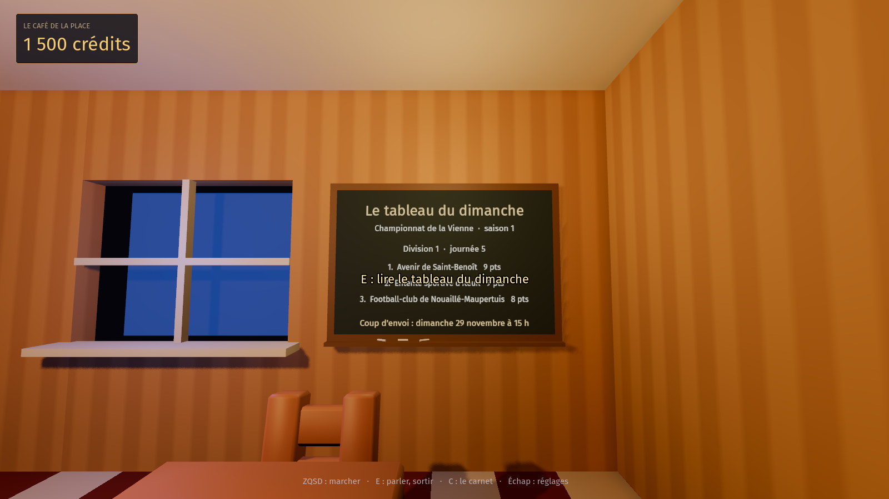

   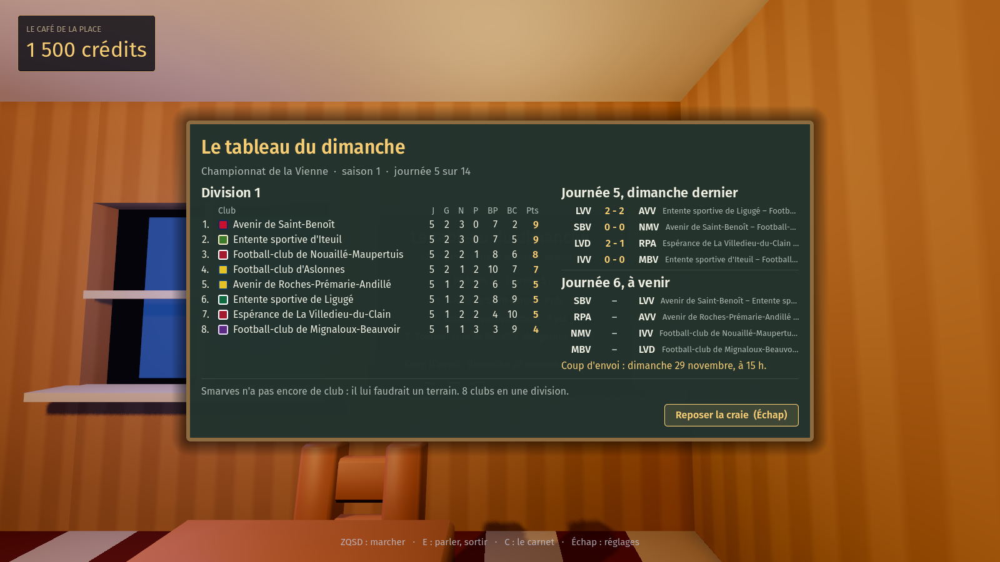
5. **Le match minute par minute** (fait le 18 octobre 2026) : `FootMatch` (`scripts/socle/foot_match.gd`) est le moteur du Vestiaire porté en GDScript, tactique, occasions, penaltys, cartons, blessures, changements de l'adjoint et commentateur compris ; `Football.effectif(club, saison)` tire dix-huit joueurs par club et par saison autour de la force du club, `Football.rencontre(saison, journee, dom, ext)` joue le match d'une traite et le garde en mémoire, et `resultat()` est son score : le même chez tout le monde, puisque la graine et les décisions (`decider` : formation, mentalité, pressing) sont les mêmes. Au café, chaque match joué de la dernière journée a sa **feuille** dans le tableau du dimanche : les buteurs, les chiffres, le récit du commentateur (pas de « revoir » : le match ne se suit qu'en direct, au stade, décision de Guillaume du 18 octobre). Test : `godot --headless --path . -s tools/test_foot_match.gd` ; capture : `--won=1000 --journee=5 --open=feuille`.

   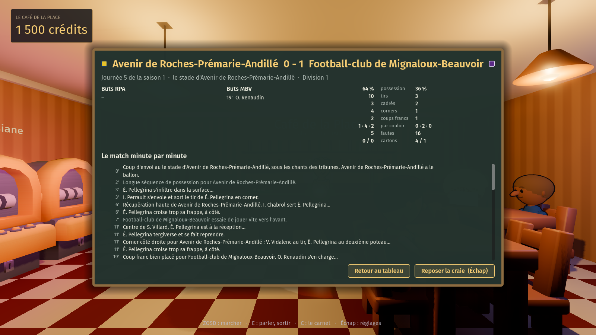
6. **Le stade de Smarves** (fait le 18 octobre 2026) : Smarves déclare son terrain dans son manifeste (`structures`, `terrain_foot`, club « L'Étoile de Smarves », ESM, bleu et or), ce qui fait de l'Étoile le premier club du registre ; le lieu « stade » (seuil 3 000 gagnés, le président Chauvin) s'ouvre par l'arche du stade municipal sur la route du Bois et mène à `scenes/stade.tscn` (`scripts/village/stade.gd`) : la pelouse sous les projecteurs, la tribune couverte, la buvette, le tableau d'affichage, et le match de l'Étoile **en direct, à l'heure réelle** du coup d'envoi (le dimanche à 15 h : une minute de jeu par minute, un quart d'heure de mi-temps ; on arrive en cours de match, on le reprend à la minute où il en est), le même état que la feuille du café (`Football.rencontre_en_direct`), les vingt-deux qui suivent le ballon, le commentateur en bas de l'écran, la tribune qui se lève au but. Le match ne se suit qu'en direct et qu'au stade (décision de Guillaume du 18 octobre) ; le résultat, lui, se lit après au café (le tableau du dimanche) et au stade (le tableau d'affichage garde le score, E devant lui ouvre la feuille). Hors match, l'Étoile s'entraîne et le tableau annonce le prochain coup d'envoi. Test : `godot --headless --path . -s tools/test_stade.gd` ; capture : `godot --path . res://scenes/stade.tscn -- --capture=stade.png --won=3000 --journee=5 --minute=30` (l'horloge mise à la 30e minute du match de la journée 5).

   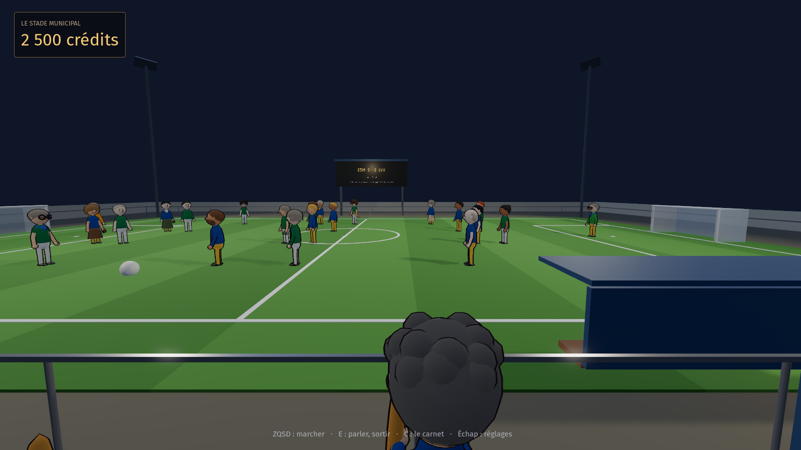

   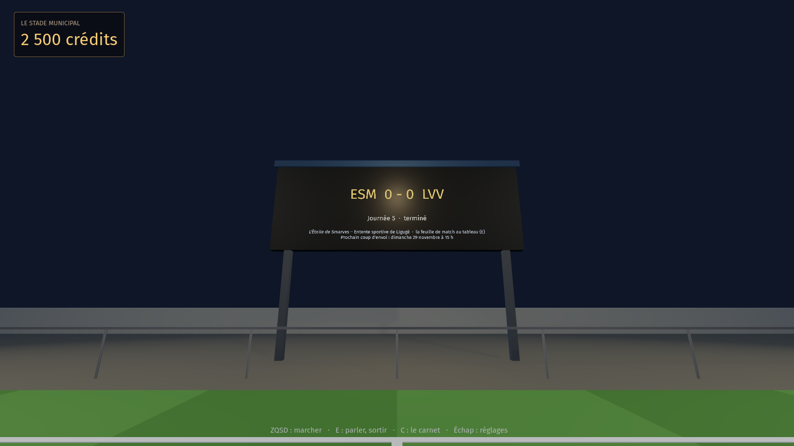
7. **Les consignes au serveur** (fait le 18 octobre 2026) : le championnat n'est pas calculé au serveur, chaque jeu le rejoue à l'identique ; la seule chose qu'un joueur y change, ce sont les consignes d'avant-match de son club (formation, mentalité, pressing), et elles entrent dans la graine. Elles sont donc tenues dans la base de Pyramides (table `smarves.consignes`, fonctions `public.smarves_consignes` et `smarves_consigne_poser`, migration `supabase/migrations/20261018140000_smarves_consignes.sql`) : `Football` les lit au lancement, sans compte aussi, et les applique avant de jouer la journée (`appliquer_consignes`, les siennes du serveur l'emportent). On les donne au stade, au **président Chauvin** (`FootCauserie`, `scripts/socle/foot_causerie.gd`) : le prochain match de l'Étoile, trois rangées de choix, « Donner la consigne ». Connecté, elle part au serveur (`decider` puis `envoyer_locales`) et le serveur refuse ce qui arrive après le coup d'envoi ; sans compte, elle reste **locale** sur l'appareil, la causerie et le tableau du café le disent, et elle part dès que le joueur se connecte si le match n'est pas passé. Qui peut parler pour un club : tout joueur connecté pour l'instant, la dernière consigne posée l'emporte et la ligne dit qui ; les parts du club viendront restreindre. Tests : `tools/test_football.gd`, `tools/test_stade.gd` ; capture : `godot --path . res://scenes/stade.tscn -- --capture=causerie.png --won=3000 --journee=5 --open=causerie`.

   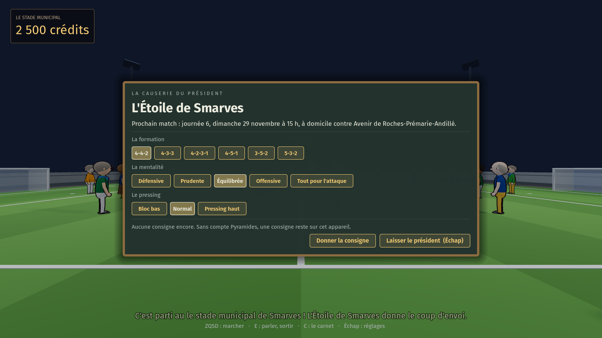
8. **Le moteur en profondeur** (fait le 18 octobre 2026, décision de Guillaume : « le moteur d'abord », l'animation ensuite) : à la Hattrick, sans en copier les chiffres. Chaque joueur a **huit compétences** (`FootMatch.COMPETENCES` : gardien, défense, jeu, aile, passe, but, coups de pied arrêtés, endurance), tirées une fois pour toutes autour de sa note au profil de son poste (`PROFILS`, `tirer_competences`, dans `Football.effectif`). Le terrain a **trois couloirs** : chaque case de formation a le sien (`couloir_de`), et `secteurs()` donne à une équipe son milieu (le jeu des milieux) et, par couloir, une défense (les défenseurs du côté, le gardien partout) et une attaque (l'aile de ceux qui y jouent ; au centre, le but des buteurs et la passe des milieux). À chaque minute le milieu décide qui a le ballon, l'attaque choisit un couloir (le centre plus souvent, et plus volontiers là où elle est forte) et s'y mesure à la défense d'en face ; sur une aile, l'ailier centre pour un buteur (reprise de la tête) ou rentre et frappe lui-même. Les **coups de pied arrêtés** ont leur tireur, le meilleur du onze dans cette compétence : les penaltys, les coups francs directs (une faute sur huit, face au mur et au gardien) et les corners (comptés comme avant, joués une fois sur trois : la tête va au plus fort dans les airs, contre la défense centrale). La **fatigue** joue comme à Hattrick : la condition baisse à chaque minute (`perte_condition` : la course du poste, le pressing, l'âge et surtout l'endurance du joueur) et toutes ses compétences baissent avec elle ; la mi-temps en rend un peu, l'adjoint sort les plus fatigués à partir de l'heure de jeu. Chaque événement dit son couloir et sa phase (`couloir`, `phase` : jeu, corner, coupFranc, penalty), le stade y pose déjà le ballon, et l'animation des actions sur la pelouse viendra là-dessus. Sur deux saisons de test, 2,35 buts par match. Test : `tools/test_foot_match.gd`. **Sur un téléphone** (demande de Guillaume du 18 octobre : « soigne la vue mobile »), les fenêtres du football tiennent dans l'écran étroit que `Tactile` donne (vers 1067 × 600) : `FootTableau._preparer` les met dans un défilement de la taille du contenu, plafonné à l'écran (`_ajuster`), replie les titres avant le bouton « Sortir », déroule le récit de la feuille en entier au lieu d'un défilement dans le défilement, et la causerie laisse ses rangées de boutons passer à la ligne. Capture : `godot --path . --resolution 1067x600 res://scenes/cafe.tscn -- --capture=feuille.png --tactile --base=600 --won=1000 --journee=5 --open=feuille`.

   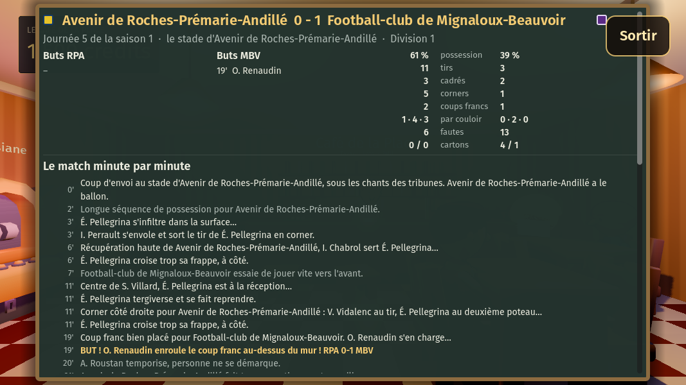
9. **L'animation des actions sur la pelouse** (fait le 18 octobre 2026, la suite du moteur) : au stade, chaque minute de match se joue en **scènes** (`stade.gd` : `_scene`, `_jouer_scenes`, `_evenement`) : la construction dans le couloir de l'action, la passe au tireur à l'entrée de la surface, ou l'ailier qui déborde jusqu'à la ligne et centre pour le buteur ; le corner tiré du poteau et repris de la tête aux six mètres ; le coup franc posé à vingt mètres ; le penalty ; puis le tir, qui finit au fond des filets (le ballon s'envole, le buteur lève les bras, le tableau change), dans les gants du gardien (qui saute et relance), à côté (le tireur hausse les épaules, le gardien va le chercher) ou sur le poteau (il revient en jeu). Le ballon levé décrit une cloche, le bloc glisse vers le ballon en longueur et en largeur, le gardien se décale sur sa ligne. Sans événement, deux passes dans son camp. Le moteur n'en sait rien : les scènes se rejouent à partir des événements (`couloir`, `phase`, `joueur`, `passeur`, `centre`, `tireur`), et un match avancé d'un coup n'en joue aucune. Capture : `godot --path . res://scenes/stade.tscn -- --capture=but.png --won=3000 --journee=4 --minute=93 --at=0,-15,180,-8 --rejouer=but@1.2 --attendre=1` (`--rejouer=type@secs` rejoue la dernière minute où c'est arrivé et avance les scènes de tant de secondes, pas à pas, parce que le rendu logiciel des captures ne fait pas avancer le temps ; `--attendre=` prend la capture après tant de secondes). Tests : `tools/test_stade.gd`.

   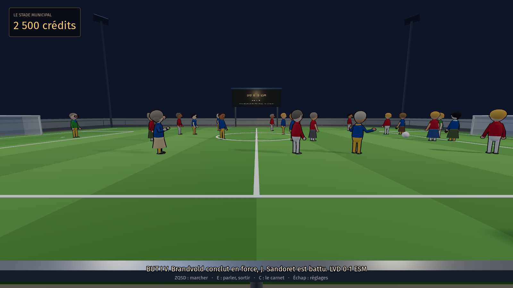

   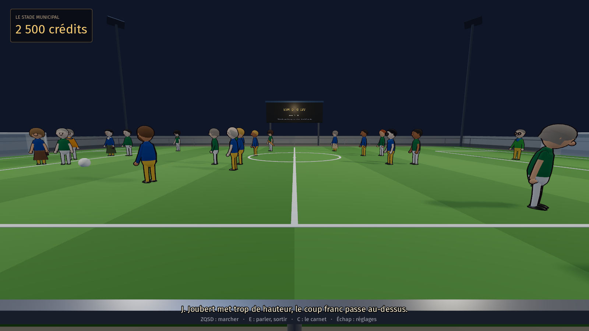
10. **Les parts du club** chez le notaire (fait le 18 octobre 2026) : à partir du seuil du stade (3 000 gagnés), Maître Garnier cède **des parts de l'Étoile de Smarves** (`Biens.CATALOGUE`, id `etoile`, cinq au plus, 1 500 crédits la première puis ×1,4 ; sur le plan de l'étude, le stade municipal au bout de la route). Une part rapporte à chaque recette comme les autres, mais sa rente annoncée suit **le classement du club** (`Football.recette_facteur` : ×1,4 en tête, ×0,7 en queue, ×1 tant que rien n'est joué) : la buvette marche mieux les dimanches de victoire. Et une part donne la parole : **qui tient le plus de parts d'un club parle pour lui** à la causerie du président (`Football.peut_decider`, chacun à égalité ; sans actionnaire, tout le monde, comme avant). En solo, le joueur est seul actionnaire dès la première part. À plusieurs, chaque jeu déclare au serveur les parts qu'il tient (`Football.detenir`, Biens le dit à l'achat et à la revente ; table `smarves.parts`, fonctions `smarves_part_declarer` et `smarves_parts`, migration `supabase/migrations/20261018180000_smarves_parts.sql`), et `smarves_consigne_poser` refuse (`raison: 'parts'`) la consigne d'un joueur qui n'est pas le premier actionnaire ; la causerie et la fiche du notaire disent qui tient quoi (`phrase_actionnaires`). Les crédits restent dans la sauvegarde : le serveur ne compte que pour départager. Tests : `tools/test_football.gd`, `tools/test_biens.gd` ; captures : `godot --path . res://scenes/notaire.tscn -- --capture=parts.png --won=3000 --lot=etoile` et `godot --path . res://scenes/stade.tscn -- --capture=causerie.png --won=3000 --journee=5 --actionnaires=vous:1,Lucien:2 --open=causerie`.

   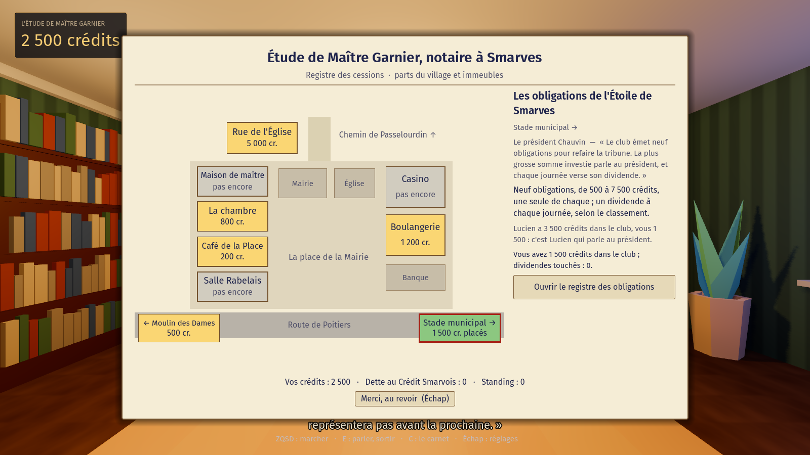

   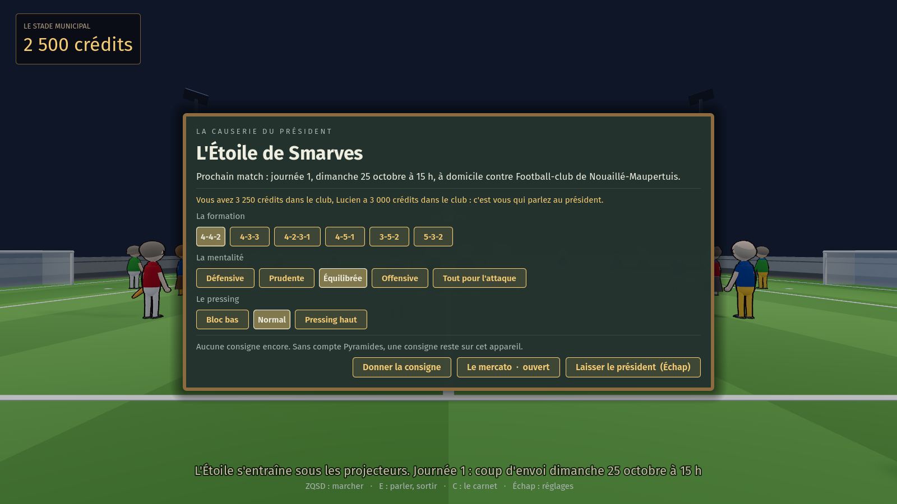
11. **Les paris au comptoir** de Josiane (fait le 18 octobre 2026) : à 2 000 gagnés, Josiane pose **le carnet du PMU** sur le zinc du Café de la Place (`salle.gd`, `SEUIL_PARIS`, `_carnet_du_pmu`) ; E l'ouvre en grand (`FootParis`, `scripts/socle/foot_paris.gd`) : les quatre matchs de la journée à venir de la division suivie, **trois cotes par match** (1, N, 2), une mise (10 à 200 crédits) ; un match coché fait un pari simple, plusieurs font un combiné dont les cotes se multiplient. Les cotes sont **fixes et les mêmes chez tout le monde** (`Paris.probabilites`, `cotes_de` : les forces des deux clubs pour la saison, l'avantage du terrain, 12 % de marge pour la maison, au vingtième près) ; la mise part tout de suite (`Game.spend`, elle compte dans le total misé comme à la machine) et le ticket se règle **le dimanche à 17 h** (`Paris.regler`, en entrant au café, Josiane le dit) : le gain rentre dans les crédits et **dans le total gagné au jeu** (`Game.cash_in`), comme un jackpot. Le coup d'envoi donné, plus de ticket sur la journée. Les tickets restent sur l'appareil (autoload `Paris`, `scripts/socle/paris.gd`, `paris.json` dans les greffes, comme les consignes) ; une nouvelle partie les emporte. La fenêtre montre les derniers tickets et le bilan depuis le début, misé et repris : les chiffres le disent, Josiane ne dit rien. Test : `godot --headless --path . -s tools/test_foot_paris.gd` ; capture : `godot --path . res://scenes/cafe.tscn -- --capture=paris.png --won=2000 --journee=5 --ticket=50 --open=paris` (`--ticket=` pose d'abord un ticket sur le match de l'Étoile).

   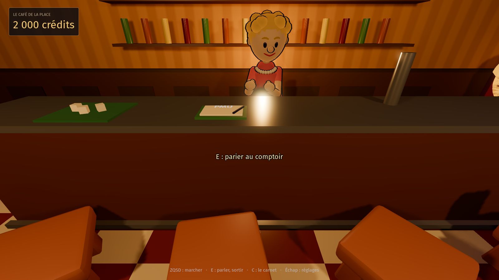

   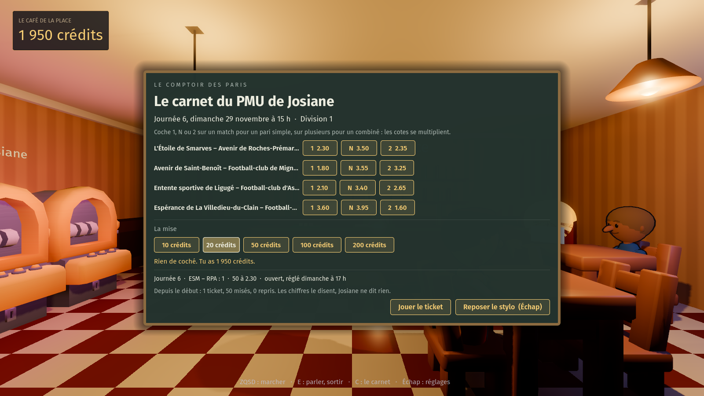
12. **Le mercato** (fait le 18 octobre 2026) : la semaine qui précède la première journée d'une saison (`Football.periode` = « mercato », `mercato_ouvert`), le président Chauvin ouvre le mercato depuis sa causerie (`FootMercato`, `scripts/socle/foot_mercato.gd`, bouton « Le mercato » de la causerie) : **douze joueurs libres par saison**, les mêmes chez tout le monde (`Football.libres` : deux gardiens, quatre défenseurs, quatre milieux, deux attaquants, tirés de la graine de la saison avec leurs huit compétences), avec leur âge, leur note et **leur prix** (`prix_de` : 1 200 crédits à 60, 3 680 à 75, 6 080 à 85). **Une recrue par club et par saison**, un libre ne part qu'une fois ; la recrue prend la place du plus faible de son poste dans l'effectif (`effectif` applique `recrue`), et le match s'en ressent chez tout le monde. C'est **celui qui parle pour le club** (le premier actionnaire, `peut_decider`) qui recrute, **de sa poche** : le club n'a pas de caisse, il a des actionnaires. Connecté, la recrue part au serveur (table `smarves.transferts`, fonctions `smarves_transfert_recruter` et `smarves_transferts`, migration `supabase/migrations/20261018190000_smarves_transferts.sql`, qui refuse hors semaine, sans la parole, une deuxième recrue ou un libre déjà pris) ; sans compte, elle reste locale sur l'appareil comme une consigne, et une recrue refusée au serveur est retirée. Hors mercato, la fenêtre se lit et dit quand le prochain s'ouvre (`prochain_mercato`). Le premier mercato est ouvert du 18 au 25 octobre 2026. Test : `tools/test_football.gd` ; capture : `godot --path . res://scenes/stade.tscn -- --capture=mercato.png --won=3000 --mercato --actionnaires=vous:2 --open=mercato` (`--mercato` pose l'horloge au milieu de la semaine du mercato de la saison 1).

   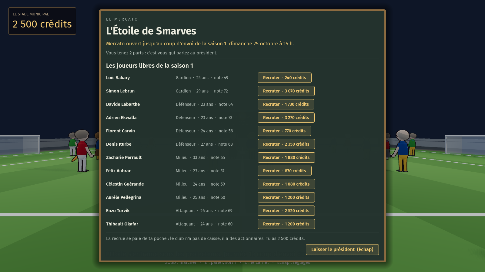

## 7. Le séquencement et les fils en cours

| # | Chantier | Fil | Dépend de |
|---|---|---|---|
| 1 | Caméra à trois crans, lisibilité des personnages, toits variés, enseignes en potence et sur les toits, construction par distance | Extension du village (caméra, façades), Personnages (signe vu d'en haut, ombre, pastilles) | — |
| 2 | Smarves décrite par un manifeste, sauvegarde en tiroirs, registre `Seuils` | un fil « Socle des communes » à ouvrir | 1 n'est pas bloquant ; à faire avant 3 pour que les nouvelles rues naissent dans le bon format |
| 3 | Route du Bois, chemin de Passelourdin, barrières de chantier, plan du village dans le carnet, repères, lieux cachés, trouvailles | Extension du village, Cohérence du monde (noms, rumeurs) | 2 |
| 4 | Chambre au-dessus du café habitable, brocante de Ginette Boutin, page « Mon logement », puis les deux maisons | Gestion de la ville | 2, et les lots `chambre_cafe`, `maison_eglise`, `maison_place` du fil Extension |
| 5 | Carte de la Vienne, car départemental, Ligugé en pack | Carte de la Vienne (carte et Ligugé faits le 18 octobre ; reste le car) | 2 ; en parallèle de 6 à 8 |
| 6 | Connexion au compte Pyramides, partie gardée sur le compte | un fil Compte (fait le 18 octobre 2026) | le mobile au point ; migration du schéma `smarves` sur accord de Guillaume |
| 7 | Multi différé : visites de maisons, livre d'or, classements au village | un fil Multi (fait le 18 octobre 2026 : panneau, noms sur les maisons, livre d'or, traces) | 4, 6 |
| 8 | Soirée partagée, tables à plusieurs, poker de Passelourdin | fil Multi, Visuel des jeux | 7 |
| 9 | Structures partagées (gare, arrêt de car, terrain), registre, pyramide du football de la Vienne | Structures partagées et football | 5 |
| 10 | La bourse à levier : la charge de Mme Vasseur rue du Clain (seuil 7 000), quatre indices réels relevés au serveur, leviers ×10 à ×100, positions au compte (fiche : [`BOURSE.md`](BOURSE.md)) | Bourse à levier (fait le 18 octobre 2026) | 6 ; l'agenda de la semaine pour ses rendez-vous |

**Notes de Guillaume du 18 octobre 2026, à garder sans les traiter maintenant :**

- **Des rendez-vous pour le temps réel (chantier 8)** : des horaires fixes pour les activités à plusieurs, par exemple la partie de poker du vendredi 13 h 30 et du dimanche 11 h, pour que les joueurs se retrouvent au même moment. Le panneau d'affichage du multi différé (chantier 7) les annonce déjà (fait). Il faudra **pousser des notifications** : sur Android, une notification locale programmée au moment où l'on s'inscrit ne demande aucun serveur, une notification envoyée par le serveur passerait par Firebase Cloud Messaging ; sur Windows, une notification n'est possible que si le jeu tourne (ou par un petit programme résident), sinon un courriel de rappel envoyé par Pyramides est la voie simple.
- **Le gain ultime** : acheter le droit de créer une nouvelle ville, construite avec les assets des villes existantes.
- **Plus tard, la construction** : des matériaux de base, puis un city builder à plusieurs où la ville est gérée comme une entreprise : ceux qui ont le plus de parts la dirigent, les minoritaires touchent des dividendes.

**Ce que cela change pour les fils en cours :**

- **Cohérence du monde** : la séparation entre ce qui vaut pour toutes les communes et ce qui est propre à Smarves est déjà dans la bible, et ce cadrage s'y appuie ; la bible gagne ensuite la carte de la Vienne, Poitiers dans la brume, la banque propre à chaque commune, Ligugé, la brocante de Ginette Boutin, les trouvailles et le livre d'or ; la ligne « pas d'export web » de la fiche de cadrage attend la réponse du fil web et mobile.
- **Personnages** : un signe vu d'en haut pour chaque personnage nommé (coiffure ou chapeau, couleur d'épaules), 50 px de haut au cran « rue », une ombre portée, une pastille pour les nommés au cran « quartier ».
- **Extension du village** : la caméra à trois crans (valeurs de la section 2, à ajuster sur captures), les toits et les enseignes, les lots des trois logements, la brocante sur `lot_a_ceder`, les barrières de chantier des rues pas encore ouvertes. Les nouvelles rues sont décrites par des données plutôt que par du code dès que le socle des communes existe.
- **Visuel des jeux** : rien à court terme. Plus tard, chaque table déclare ses places numérotées, pour les tables à plusieurs.
- **Gestion de la ville** : le dictionnaire `logements`, le genre `meuble`, la brocante, le choix habiter ou louer, la reprise meublée, la page « Mon logement ». Rien ne change aux recettes, aux prix ni aux seuils.

## Cibles

**Tranché par Guillaume le 17 octobre 2026 : Windows et téléphone (Android, puis iOS) ; le web seulement si nécessaire.** Le détail et la liste des chantiers pour le téléphone sont dans [`WEB-MOBILE.md`](WEB-MOBILE.md).

- **Le rendu** : Forward+ sur ordinateur, rendu Mobile sur téléphone (réglage par plateforme, sans toucher au rendu Windows). Chaque nouveau lieu se vérifie aussi en rendu Mobile, qui n'a ni SDFGI, ni SSIL, ni SSR, ni brouillard volumétrique, ni SSAO.
- **Les contrôles** : chaque lieu prévoit ses gestes tactiles en même temps que le clavier et la souris (toucher pour marcher, glisser pour tourner, pincer pour changer de cran).
- **Le multi** : WebSocket (Supabase Realtime sur `WebSocketPeer`) et `HTTPRequest`, jamais ENet ni UDP, pour que le web reste possible sans rien récrire. Sur téléphone aussi, la connexion PKCE revient par la boucle locale (section 4).
- **Les communes greffées** : en paquets de ressources avec du GDScript, jamais de GDExtension, qui demanderait un build par plateforme.
- **Les mods sur le web**, si le web vient un jour : un pack `.pck` doit être téléchargé dans le stockage du navigateur avant d'être chargé.
