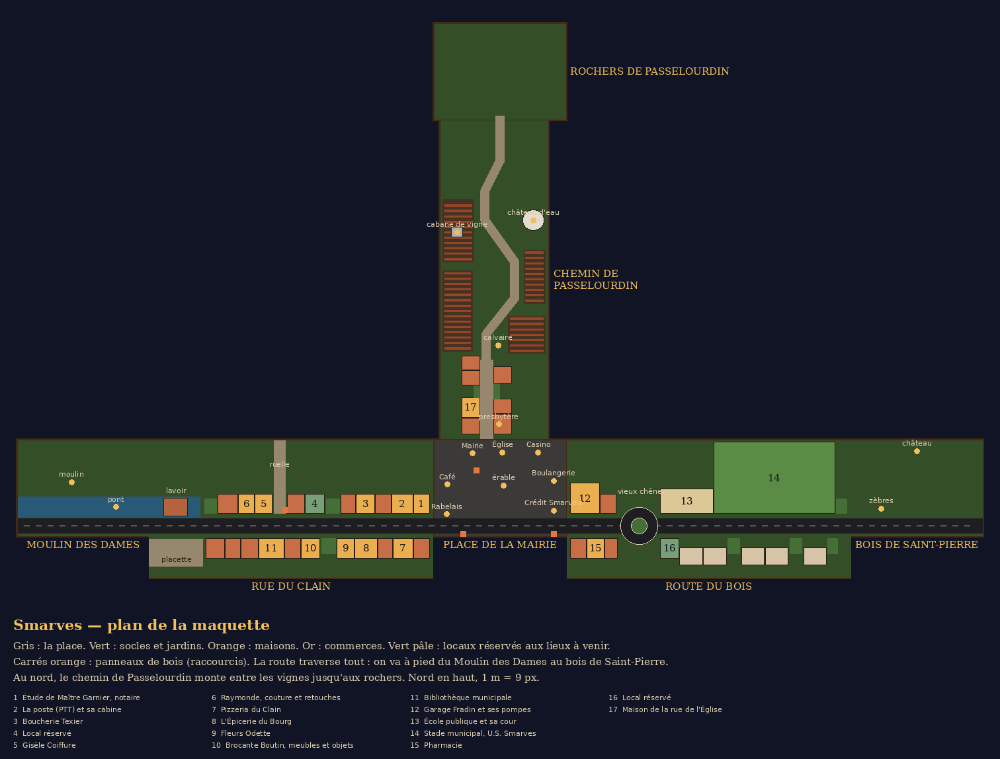

# Le village : rues, quartiers et emplacements

Ce document dit comment le village s'étend autour de la place, où sont les entrées des lieux, et comment un autre chantier demande sa place dans la rue. Le code est dans `scripts/village/` (`bois.gd` pour la route du Bois, `passelourdin.gd` pour le chemin de Passelourdin) ; le plan se redessine avec `python3 tools/plan_village.py docs/captures/village-plan.png`.

## Le principe

**Une seule maquette.** Les socles des environs ne sont plus des îles : des rues partent de la place et y mènent à pied, posées sur leurs propres planches de noyer, chacune avec sa plaque dorée. Les panneaux de bois restent comme raccourcis (on y voyage d'un clic ou avec E), mais on peut toujours marcher.

**Les vrais noms, des commerces inventés** (bible, section 4). Les rues suivent la géographie du vrai Smarves : le Clain à l'ouest, le bois de Saint-Pierre à l'est, Passelourdin au nord au-dessus du Miosson. Les commerces reprennent ce que le vrai bourg a (poste, boucherie, boulangerie, supérette, fleuriste, pizzeria, coiffeurs, bibliothèque, garage), sous des noms inventés tirés de la réserve de la bible.

**Le bourg du Poitou, en jouet.** Les façades sont construites dans le code (`scripts/village/facades.gd`) : calcaire crème, chaînes d'angle et encadrements en pierre claire, tuiles canal ocre, volets peints, devantures de bois, stores rayés, jardinières de géraniums, portails à boules, murs de jardin à chaperon de tuiles. Toute une rue tient en une poignée de maillages (un par matière) et ses vitres en un seul MultiMesh, dont les fenêtres s'allument et s'éteignent au hasard.

**La coupe de maquette.** En vue de dessus, les maisons du premier plan se percent en pointillé autour de l'habitant qu'on dirige (`shaders/village_cutaway.gdshaderinc`) : on voit toujours le petit renard, même dans une rue étroite.

## Les quartiers

| Quartier | Où | Ce qu'on y trouve | État |
|---|---|---|---|
| La place de la Mairie | socle central | café, mairie, église, casino, boulangerie, Crédit Smarvois, salle Rabelais | existant |
| La rue du Clain | à l'ouest, de la place au pont du Moulin des Dames | étude de Maître Garnier, la poste et sa cabine, boucherie Texier, Gisèle Coiffure, Raymonde couture, pizzeria du Clain, l'Épicerie du Bourg, Fleurs Odette, bibliothèque, le lavoir sur le Clain, la placette | posée |
| La route du Bois | à l'est, de la place à l'allée du château | le garage Fradin et ses pompes, la pharmacie, le rond-point du vieux chêne, l'école publique et sa cour, le stade municipal et sa tribune, les pavillons des années 70 | posée |
| Le chemin de Passelourdin | au nord, entre la mairie et l'église | la rue de l'Église (le presbytère, la maison qu'on peut acheter), le chemin de terre en lacets entre les vignes vendangées, le calvaire, le château d'eau peint au nom du bourg, la cabane de vigne, la lisière et le banc du point de vue, jusqu'aux rochers | posé |

## Les emplacements (pour les autres chantiers)

Chaque devanture du village est un emplacement nommé, dans `village.gd` (`NORTH_ROW`, `SOUTH_ROW` pour la rue du Clain, `BOIS_NORTH`, `BOIS_SOUTH` pour la route du Bois). Une fois la rue construite, `Village.lots[id]` donne `pos` (milieu du pied de façade), `rot` (orientation), `w`, `d`, `door` (la porte, en coordonnées du monde) et `area` (la zone d'entrée, une `Area3D` avec ses métadonnées `interact`, `lot` et `prompt`). Le nœud s'appelle `Village`, enfant de la scène principale.

| Id | Ce que c'est | Rue | Branché sur |
|---|---|---|---|
| `notaire` | L'étude de Maître Garnier, plaque de cuivre | rue du Clain, côté nord, à l'angle de la place | `Biens.SELLERS.notaire.scene` |
| `couture` | Raymonde, couture et retouches, mannequins en vitrine | rue du Clain, côté nord, à côté de Gisèle Coiffure | `Biens.SELLERS.couture.scene` |
| `garage` | Le garage Fradin, porte d'atelier à moitié ouverte, cour à pompes | route du Bois, côté nord, au sortir de la place | `Biens.SELLERS.garage.scene` |
| `poste`, `boucherie`, `coiffure`, `pizzeria`, `epicerie`, `fleurs`, `bibliotheque` | commerces du bourg, éclairés, fermés au joueur pour l'instant | rue du Clain | décor |
| `pharmacie` | la pharmacie et sa croix verte | route du Bois, côté sud | décor |
| `ecole`, `stade` | l'école publique (porte d'entrée) et le stade municipal (arche d'entrée) | route du Bois, côté nord | décor |
| `lot_reserve` | local réservé, vitrine passée au blanc, « Prochainement » | rue du Clain, côté nord | libre |
| `brocante` | Brocante Boutin, meubles et objets (Ginette Boutin), sur l'ancien local à céder | rue du Clain, côté sud | `Biens.SELLERS.brocante.scene` |
| `chambre_cafe` | la chambre au-dessus du café, porte et escalier dans la ruelle au nord du café | place | `Biens.door_of` |
| `maison_place` | la maison de maître, la maison verte au fond de la place | place | `Biens.door_of` |
| `maison_eglise` | la maison de la rue de l'Église, toit d'ardoise, volets bleus | chemin de Passelourdin, côté ouest | `Biens.door_of` |
| `lot_bois` | local réservé, « Prochainement », juste après le rond-point | route du Bois, côté sud | libre |

**Entrer chez un vendeur.** La porte appelle `get_tree().change_scene_to_file(Biens.SELLERS[id].scene)` ; tant que la scène n'existe pas, une annonce dit que le lieu ouvre bientôt. **En sortir** : la scène met `Game.return_point` à l'id de la porte (`notaire`, `couture`, `garage`) et la scène principale replace l'habitant sur le trottoir, face à la rue (`Village.door_spawn`).

**Les logements.** La porte d'un logement demande `Biens.door_of(lot)` : chez soi, elle appelle `Biens.enter(door_of(lot).logement)` quand l'intérieur existe (une seule scène, `logement.tscn`, pour tous) et l'on ressort devant la porte (`Game.return_point` = l'id du lot) ; sinon elle dit « propriété privée » ou « en vente chez Maître Garnier ».

**Brancher une action sur une porte.** Toute `Area3D` qui porte la métadonnée `action` (un `Callable`) est appelée quand on appuie sur E devant elle, ou quand on clique dessus en vue maquette. C'est ainsi que marchent les portes des vendeurs et la tournée générale.

**La tournée générale.** En terrasse du Café de la Place, entre les deux tables : « E : offrir une tournée générale (prix) », qui appelle `Biens.offer_tournee()`.

**Demander une place.** Un nouveau lieu dans la rue passe par ce chantier : on ajoute une entrée à l'une des rangées (ou on prend un local réservé), avec son id, son enseigne, et son invite dans `PROMPTS`. Rien d'autre n'est à toucher dans la scène principale.

## Les passages

- **Place → rue du Clain → Moulin des Dames** : la route continue à pied jusqu'au pont du moulin ; le bord ouest de la place et le bord est du socle du moulin sont ouverts (`village.gd`, `OPENINGS`).
- **Place → route du Bois → bois de Saint-Pierre** : la route passe le rond-point du vieux chêne et arrive à l'allée du château ; le bord est de la place et le bord ouest du socle du bois sont ouverts. Les voitures contournent le chêne (`bois.gd`, `road_z`).
- **Place → chemin de Passelourdin → rochers** : on passe entre la mairie et l'église, on remonte la rue de l'Église et le chemin de terre jusqu'à l'entrée des rochers ; le bord nord de la place et le bord sud du socle des rochers sont ouverts.
- **Rue du Clain → Passelourdin** : la ruelle au milieu de la rue, avec son panneau « Rochers de Passelourdin ↑ » (raccourci).
- Les panneaux de la place restent des raccourcis vers chaque socle.

## Vérifier

- Capture d'une vue maquette libre : `godot --path . res://scenes/main.tscn -- --capture=sortie.png --vue=distance,x,y,z,lacet,tangage`.
- Capture en vue de dessus derrière l'habitant : `godot --path . res://scenes/main.tscn -- --capture=sortie.png --at=x,z,lacet`.
- Sans carte graphique (conteneur, CI) : Vulkan logiciel avec `VK_ICD_FILENAMES=/usr/share/vulkan/icd.d/lvp_icd.json` sous `xvfb-run`, environ quatre minutes par capture.

## Les repères et les lieux cachés

- **Le château d'eau** (chemin de Passelourdin) : un fût de béton, une cuve en champignon peinte « SMARVES », un projecteur au pied et un feu rouge qui clignote au sommet. C'est le plus haut point de la maquette, on le voit de la place en vue Quartier.
- **Le calvaire** du premier lacet, avec son lumignon.
- **Les enseignes sur les toits** : côté sud des rues, les boutiques tournent le dos à la caméra ; leur nom est donc aussi sur le toit, sur un panneau penché vers la vue de dessus (`spec.roof_sign`, `Facades.roof_sign`).
- **La cabane de vigne** (lieu caché) : au milieu des rangs, à l'ouest du chemin, sa porte donne au nord, à l'abri des regards de la place. La première fois qu'on la pousse, on repart avec l'affiche du loto de 1987 (`Biens.trouvailles`, `affiche_loto_1987`) ; ensuite, il n'y a plus qu'un clou au mur.

## Pour le plan du Carnet : quartiers et lieux cachés

- `Village.ZONES` : id → `{nom, rect}`, où `rect` est un `Rect2` en coordonnées du monde (x, z, largeur, profondeur). Il y en a une par socle : `place`, `rue_du_clain`, `route_du_bois`, `chemin_passelourdin`, `moulin`, `bois`, `rochers`.
- `Village.zone_at(pos)` donne le quartier qui contient un point. `Village.current_zone` est celui de l'habitant, et le signal `zone_entered(id)` part à chaque changement, y compris au premier pas et après un raccourci.
- `Village.CACHES` : id → `{nom, zone, pos}`. Le signal `cache_found(id)` part la première fois qu'on trouve un lieu caché. Il n'y a pour l'instant que `cabane_vigne`.
- Le village ne garde rien en mémoire : ce qui a été découvert va dans le tiroir Smarves de la sauvegarde, tenu par le Carnet.
