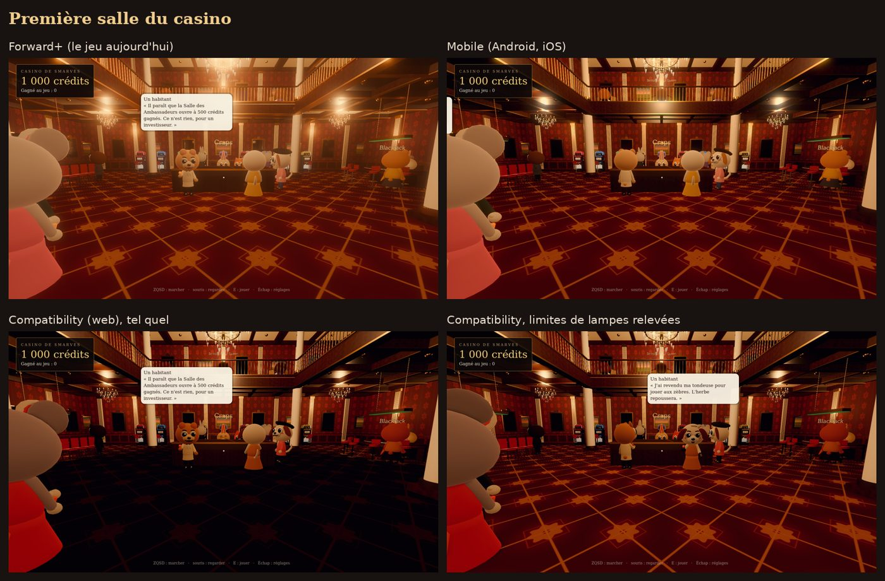

# Smarves en web et sur mobile

Ce que donnerait le jeu dans un navigateur ou sur un téléphone, mesuré sur le projet tel qu'il est (Godot 4.7.2, rendu Forward+, physique Jolt) le 17 octobre 2026. Rien de ce qui est décrit ici n'est appliqué au jeu : le rendu reste en Forward+.

## En bref

Oui, le jeu tourne déjà dans un navigateur : l'export web passe sans toucher au code et Chromium affiche l'écran titre puis la place. Mais le web n'a qu'un seul rendu, Compatibility (WebGL 2), qui n'a ni l'éclairage indirect (SDFGI, SSIL), ni le brouillard volumétrique, ni les reflets (SSR), ni le flou de profondeur. Le village et les tables y perdent peu ; le casino, qui vit de ses lustres et de leur rebond sur la moquette, perd beaucoup, et deux réglages en rattrapent l'essentiel. Sur mobile en natif, le rendu Mobile garde presque tout l'éclairage direct ; le vrai chantier est ailleurs : le jeu n'a aucune commande tactile.

## Décision (17 octobre 2026)

Guillaume : le mobile est une cible, le web ne l'est que si nécessaire.

- Sur téléphone (Android, iOS), le jeu tournera avec le rendu Mobile ; l'ordinateur garde Forward+. Godot le permet par plateforme avec `rendering/renderer/rendering_method.mobile="mobile"`, sans toucher au rendu Windows.
- Chaque nouveau lieu prévoit ses commandes tactiles en même temps que le clavier et la souris.
- Le réseau reste Supabase (HTTP et Realtime en WebSocket), jamais ENet ni UDP : il marche aussi dans un navigateur, la porte du web reste ouverte sans rien coûter.
- Les communes greffées sont des paquets de ressources en GDScript, sans GDExtension.
- Le web ne se prépare pas d'avance ; les étapes de « Ce qu'il faudrait pour un export web aujourd'hui » servent le jour où il devient nécessaire.

## Ce que le rendu utilise aujourd'hui

- `project.godot` : Forward+, Jolt Physics, MSAA 3D ×2, ombres douces qualité 3, Direct3D 12 sous Windows.
- Environnements (`main.gd`, `casino_interior.gd`, `shop_interior.gd`, `tools/table_lab.gd`) : SDFGI avec occlusion, SSIL, SSAO, brouillard volumétrique, glow, tonemap AgX, correction colorimétrique ; SSR dans le casino ; flou de profondeur en vue maquette.
- Deux `FogVolume` (fumée du Fumoir, brume de Passelourdin) avec un shader de type `fog`.
- Beaucoup de lampes dynamiques : plus de 32 dans la première salle du casino (voir plus bas).
- Shaders maison (13, `shaders/`) : tous de type `spatial` ou `sky`, sans lecture de l'écran ni de la profondeur. Celui des habitants (`critter.gdshader`, plafond de l'albédo, rim light) compile et rend pareil en Compatibility.
- Particules GPU (`jeux/kit.gd`), pas de décals.
- Son : bus Ambiance et Bruitages, et une musique fabriquée à la volée par `AudioStreamGenerator` (`sfx.gd`).
- Sauvegardes dans `user://`, souris capturée en vue à pied, aucune gestion du toucher (`InputEventScreenTouch` n'apparaît nulle part).

## Ce que dit la documentation de Godot 4.7

- **Web** : seul le rendu Compatibility (WebGL 2.0) est disponible ; Godot ne prend pas encore en charge WebGPU. Les exports à un seul fil d'exécution (par défaut depuis 4.3) n'ont pas besoin des en-têtes COOP/COEP ; les exports multifils, si. Pas de C#, GDExtension seulement compilée pour le web. Réseau : HTTP, WebSocket et WebRTC, pas de TCP ni d'UDP bruts. Le son par défaut (mode « sample ») ne passe pas les effets de bus. Plein écran et capture de la souris seulement après un geste du joueur. Safari a des soucis de WebGL 2 que Chrome et Firefox n'ont pas.
- **Rendus** : Compatibility n'a ni SDFGI, ni VoxelGI, ni SSIL, ni SSR, ni brouillard volumétrique, ni décals ; il garde SSAO, glow, tonemap et MSAA ; 8 lampes omni ou spot par objet. Le rendu Mobile n'a pas non plus SDFGI, SSIL, SSR ni brouillard volumétrique, et pas de SSAO, mais 256 lampes par vue. Forward+ marche sur téléphone mais « mal optimisé », Godot conseille Mobile ou Compatibility.
- **Jolt** : la page ne parle pas des plateformes. L'export web s'est chargé sans erreur de physique (voir plus bas), mais je n'ai pas fait marcher le personnage dans le navigateur.

## Mesures

Rendu logiciel du conteneur (lavapipe pour Vulkan, llvmpipe pour OpenGL), mêmes vues dans les trois rendus, sauf la place en rendu Mobile, qui n'a pas abouti en rendu logiciel en vingt minutes. Les planches sont dans le dossier du projet `smarves/web/` ; celle du casino est copiée ici.



- **Place en vue de dessus** : très proche. Compatibility perd le voile de brume et le flou de profondeur en haut de l'image ; la place est un peu plus plate et plus claire.
- **Blackjack, assis** : presque identique. La croupière et le tapis rendent pareil, le plafond de la fourrure tient.
- **Première salle du casino** : en Compatibility la moquette devient presque noire. La cause est la limite de 32 lampes visibles du rendu OpenGL (`rendering/limits/opengl/max_renderable_lights`), pas l'absence de SDFGI : en passant cette limite à 256 et `max_lights_per_object` à 64, la salle retrouve ses lustres et ressemble au rendu Mobile. Il manque encore le rebond chaud et la brume dorée de Forward+.
- **Navigateur** : export web à un seul fil, 50 Mo (39,5 Mo de WebAssembly, 11,6 Mo de données), 21 Mo une fois compressé en gzip. Chromium (WebGL 2 par SwiftShader) charge le jeu en quelques secondes, affiche l'écran titre et, après « Jouer », la place avec Josiane et la tournée générale. Deux défauts vus à l'écran : les puces « ● » de la liste du village sortent en carrés (le navigateur n'a pas les polices du système, il faut une police embarquée qui a ces signes), et le son attend un clic pour démarrer. La seule erreur est celle du shader `fog`. La cadence en rendu logiciel (moins d'une image par seconde) ne dit rien de celle d'une vraie carte graphique ; je n'ai pas pu la mesurer ici.

## Ce qu'il faudrait pour un export web aujourd'hui

1. Un préréglage d'export « Web » (à un seul fil, sans PWA), et un workflow qui le publie, par exemple sur GitHub Pages.
2. Les deux limites de lampes, réservées au web avec le suffixe de fonctionnalité (`max_renderable_lights.web=256`, `max_lights_per_object.web=64`), pour ne rien changer au jeu Windows.
3. Ne pas créer les deux `FogVolume` en Compatibility (`RenderingServer.get_current_rendering_method()`), et remplacer la brume par du brouillard de profondeur ou des plans transparents.
4. Une police embarquée qui couvre tous les signes affichés.
5. Écouter le son dans un vrai navigateur (pas fait ici, le conteneur n'a pas de sortie audio) : la musique fabriquée par `AudioStreamGenerator` ne relève sans doute pas du mode « sample » et passerait par le mode « stream », plus sujet aux craquements sans fils d'exécution. Sinon, des boucles enregistrées.
6. Pour se rapprocher de Forward+ dans le casino : éclairage précuit (`LightmapGI`, affiché par Compatibility) ou quelques lampes d'appoint sans ombre.

Les points 1 à 4 tiennent en une journée ; le 5 et le 6 sont du réglage lieu par lieu.

## Mobile

- **En natif (Android, iOS)** : le rendu Mobile garde la moquette et les lustres du casino (planche ci-dessus) ; il perd SDFGI, SSIL, SSR, le brouillard volumétrique et le SSAO. C'est le meilleur rendu pour téléphone, mieux que Compatibility.
- **Dans le navigateur d'un téléphone** : Compatibility comme sur ordinateur, avec moins de mémoire et de puissance, et Safari sur iPhone moins fiable en WebGL 2.
- **Ce qui manque dans les deux cas** : des commandes tactiles (déplacement, regard, interaction, zoom de la maquette), une interface lisible sur petit écran, et un budget de lampes et d'ombres pour la chaleur et la batterie.

## Signature de l'APK Android

Android n'installe que des APK signés, et n'installe une mise à jour par-dessus que si elle est signée par la même clé. La clé n'est jamais dans le dépôt (il est public) : elle vit dans les secrets du dépôt, que seuls ses administrateurs voient et que GitHub ne passe jamais aux PR venues d'un fork.

- **Sur main** (le `Smarves.apk` de la Release « derniere-version ») : signé par la clé de version, lue dans les secrets `SMARVES_ANDROID_KEYSTORE` (le fichier de clés en base64) et `SMARVES_ANDROID_PASSWORD` (son mot de passe), alias `smarves`. Tant que ces secrets n'existent pas, main signe avec la clé provisoire gardée dans le cache des Actions depuis le 17 octobre 2026 (stable d'un build à l'autre, mais un cache s'efface après sept jours sans build et reste lisible par un workflow modifié dans une PR : elle ne doit plus servir une fois les secrets en place). Pour que le cache ne l'efface pas pendant une pause, le workflow la relit chaque lundi matin (job `garder-la-cle`, déclenchement planifié) ; GitHub désactive les workflows planifiés d'un dépôt public après soixante jours sans activité, un « Run workflow » manuel dans Actions suffit alors à les relancer.
- **Sur les PR** : une clé jetable fabriquée dans le job. Cet APK sert à essayer ; il ne s'installe pas par-dessus celui de la Release (il faut désinstaller d'abord).

**Créer la clé de version, une seule fois** (Guillaume, sur son PC) :

1. Il faut `keytool`, livré avec Java : par exemple celui d'Android Studio (`C:\Program Files\Android\Android Studio\jbr\bin\keytool.exe`) ou d'un JDK Temurin.
2. Dans PowerShell, dans un dossier qui ne sera jamais versionné :
   ```powershell
   keytool -genkeypair -keystore smarves-release.keystore -storetype PKCS12 -alias smarves -keyalg RSA -keysize 4096 -validity 10000 -dname "CN=Smarves, O=Smarves, L=Smarves, C=FR"
   [Convert]::ToBase64String([IO.File]::ReadAllBytes("smarves-release.keystore")) | Set-Clipboard
   ```
   `keytool` demande un mot de passe (le même sert pour la clé). La seconde ligne copie le fichier en base64.
3. Sur GitHub, dépôt smarves, Settings, Secrets and variables, Actions, New repository secret : `SMARVES_ANDROID_KEYSTORE` = le contenu copié, puis `SMARVES_ANDROID_PASSWORD` = le mot de passe.
4. Garder `smarves-release.keystore` et son mot de passe en lieu sûr (gestionnaire de mots de passe, sauvegarde hors du PC). Perdue, la clé ne se recrée pas : chaque joueur devrait désinstaller pour passer à une nouvelle.
5. Supprimer l'ancienne clé provisoire : Actions, Caches, entrée `smarves-android-keystore-v1`.

Au premier APK signé par la clé de version, il faut désinstaller une fois l'APK installé avant (signé par la clé provisoire) ; les suivants s'installent par-dessus.

**Google Play** : pour une publication sur le Play Store, cette même clé servira de clé d'envoi (« upload key ») ; Google signe ensuite l'application avec sa propre clé (Play App Signing), et une clé d'envoi perdue peut y être réinitialisée par le support. Il faudra alors exporter un AAB (`gradle_build/export_format`) plutôt qu'un APK. Tant que le jeu n'est pas sur le Play Store, Android affiche l'avertissement « source inconnue » à l'installation, quelle que soit la clé.

## Les mises à jour

Chaque export range le commit construit dans `res://version.json` (le greffon d'éditeur `addons/smarves_version`, actif dans `project.godot` ; le workflow n'y est pour rien). Au lancement, le jeu exporté lit sur l'API de GitHub, sans compte, les derniers commits de l'étiquette `derniere-version` (autoload `Version`, `scripts/socle/version.gd`). Si l'étiquette est sur un autre commit, la bienvenue annonce une nouvelle version, avec les titres des commits arrivés depuis, et son bouton ouvre dans le navigateur le fichier de la Release pour cette plateforme (`Smarves-installateur.exe` ou `Smarves.apk`). Lancé depuis l'éditeur (pas d'estampille), sur le web, hors ligne ou au-delà de la limite de GitHub (60 lectures par heure et par adresse), le jeu se tait. L'APK et l'installateur Windows sont ajoutés à la Release quelques minutes après le déplacement de l'étiquette : le lien peut répondre 404 pendant ce temps. `tools/test_version.gd` vérifie la comparaison.

## Ce qu'il aurait fallu décider au départ

- Choisir le rendu cible dès le premier jour : Compatibility si le web compte, Mobile si ce sont les applications. La direction artistique se règle alors sur ce rendu au lieu d'être rattrapée.
- Garder l'éclairage sous un plafond de lampes visibles, et précuire la lumière des intérieurs plutôt que compter sur SDFGI.
- Prévoir les commandes tactiles avec les commandes clavier et souris.
- Embarquer les polices, et fixer un budget de téléchargement.

## Conséquences pour la suite

- **Multijoueur** : dans un navigateur, ni ENet ni UDP, seulement WebSocket ou WebRTC. Le multi prévu dans [`SUITE.md`](SUITE.md) passe par Supabase (HTTP et Realtime sur WebSocket), qui marche pareil en natif et dans un navigateur.
- **Logements** : l'état partagé vit sur le serveur ; les sauvegardes locales du navigateur (IndexedDB derrière `user://`) peuvent être effacées par le navigateur.
- **Mods et autres villes** : un mod en paquet de ressources (`.pck`) avec du GDScript se charge avec `ProjectSettings.load_resource_pack` après l'avoir téléchargé dans `user://`, ce qui devrait marcher aussi dans un navigateur (non essayé ici). Un mod en GDExtension demande un build web à part et le modèle d'export avec extensions : à éviter pour des mods.
- **Carte de la Vienne** : charger les villes à la demande, par paquets, plutôt que tout dans le premier téléchargement. 21 Mo compressés pour le village seul est raisonnable ; chaque ville en plus dans le paquet principal rallonge l'attente sur le web.

## Les chantiers pour le téléphone

Dans l'ordre où les faire. Chaque point dit ce qu'il y a aujourd'hui et ce que je recommande.

1. **Export Android et rendu Mobile.** *Fait* : préréglage « Android » (arm64, signé par une clé fabriquée dans le workflow et gardée en cache), rendu Mobile sur téléphone et repli OpenGL, APK de 38 Mo publié dans la Release « derniere-version » à côté de l'exécutable Windows. Avant : Ajouter un préréglage Android (arm64 seulement, textures ETC2/ASTC), `rendering_method.mobile="mobile"` et le repli `rendering_device/fallback_to_opengl3=true` pour les téléphones sans Vulkan, et un workflow qui construit l'APK comme celui de Windows. C'est le premier pas parce que tout le reste se juge sur un vrai téléphone. Taille à mesurer : le modèle Android de Godot, toutes architectures, pèse 105 Mo ; en arm64 seul, plus les 11,6 Mo de données du jeu, on peut attendre de l'ordre de 40 à 60 Mo (estimation, pas mesurée).
2. **Déplacement et regard au toucher.** *Fait* (autoload `Tactile`, `scripts/tactile/tactile.gd`, actif seulement sur téléphone ou avec `--tactile`), comme recommandé ci-dessous. Avant : `fp_player.gd` lit ZQSD et les flèches, Maj pour courir, la souris capturée pour regarder ; `orbit_camera.gd` tourne au clic droit et zoome à la molette. Recommandation : en vue de dessus, toucher le sol pour y marcher (le personnage s'y rend), glisser à un doigt pour tourner, pincer pour changer de cran ; en vue à pied, un pouce virtuel à gauche et un glissé à droite pour regarder. Le pincement remplace la molette des crans.
3. **L'action E et les invites.** *Fait* : l'invite devient un bouton, toucher agit comme E, boutons Vue, Carnet et Menu, retour d'Android sur Échap. Avant : E (ou le clic) agit sur ce qu'on regarde, et l'invite « E : … » s'affiche au centre. Recommandation : sur téléphone, l'invite devient un bouton qu'on touche, au même endroit, et toucher directement une porte ou un habitant fait la même chose. Tab (vue à pied ou de dessus) et C (le carnet) deviennent deux boutons fixes dans un coin.
4. **Les tables assises.** Chaque table a déjà son bouton « Quitter » ; l'agrandissement de leurs boutons et textes est confié au fil Visuel des jeux, dans sa refonte des panneaux. Avant : chaque table a ses boutons à l'écran (la barre de jeu) et des raccourcis (Espace, C, R, D, Échap). Les boutons marchent déjà au toucher, parce que Godot transforme le toucher en clic ; recommandation : les agrandir sur téléphone (au moins 48 px réels) et ajouter un bouton « Quitter » là où seul Échap existe.
5. **Le carnet et les panneaux.** Aujourd'hui « Fermer le carnet : C ou Échap ». Recommandation : un bouton de fermeture et le retour d'Android branché sur `ui_cancel`, qui ferme déjà la plupart des panneaux (14 endroits l'écoutent).
6. **Lisibilité sur petit écran.** *Fait* sans toucher aux scènes : l'autoload `Tactile` règle la base d'écran d'après la taille réelle de l'écran (environ 222 unités par pouce de hauteur, entre 600 et 900). Sur un téléphone de 6 pouces en paysage, la base passe à 1067 × 600 et tout grossit de moitié ; une tablette garde 1600 × 900. Vérifié en 2400 × 1080 sur la place, le café, la banque, les réglages, le blackjack, la roulette et le hall du casino : tout tient à l'écran. Les textes des tables restent petits (barre de jeu en 16) : ils sont repris par le fil Visuel des jeux (20 px minimum, boutons de 48 px). Avant : l'interface est dessinée pour 1600 × 900 avec beaucoup de textes en 10, 12, 14 et 15 px ; sur un téléphone de 6 pouces en paysage, 15 px font environ 1,4 mm de haut. Recommandation : sur téléphone, une base de 1280 × 720 (`window/size/viewport_width.mobile`), qui grossit tout de 25 %, et un plancher de 20 px pour les textes qu'on doit lire (invites, bulles, prix).
7. **Budget de performance.** Le casino fait encore environ 2 400 appels de dessin à l'entrée après le regroupement statique (mesure d'un autre fil, pas refaite ici). Sur un téléphone moyen, viser plutôt moins de 1 000 (ordre de grandeur courant, pas une limite de Godot) : fusionner davantage les décors (MultiMesh pour les chaises, les machines, les balustres), couper les ombres des petites lampes, et limiter les lampes visibles. À mesurer sur un vrai téléphone dès le point 1, avec le compteur d'images par seconde.
8. **iOS.** Même travail que pour Android une fois celui-ci fait ; il faut un Mac avec Xcode et un compte développeur Apple pour signer.
